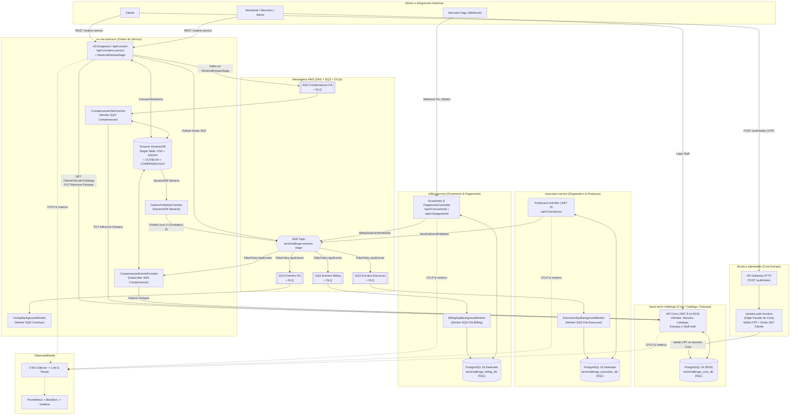

> 📅 **Atualizado em 2026-11-14** | Documento técnico consolidado refletindo o estado verificado dos repositórios.  
> 📄 **Documento de Entrega no Portal (PDF):** [`ENTREGA_PORTAL_FASE4.md`](./ENTREGA_PORTAL_FASE4.md) | **Inventário & Divergências de Contratos:** [`README.md`](./README.md) · [`PENDENCIAS_CONTRATOS.md`](./PENDENCIAS_CONTRATOS.md)

# 🗺️ Arquitetura Consolidada, Fluxo Completo, Contratos e Validação da Fase 4

Documento técnico consolidado com a **arquitetura implementada**, o **inventário real de contratos e mensageria**, e a **auditoria de conformidade contra os requisitos obrigatórios da Fase 4 (`FASE_4.md`)**.

---

## 📌 1. Visão Geral dos Componentes do Ecossistema

O ecossistema é composto por **8 repositórios** organizados em microsserviços desacoplados, persistência poliglota, mensageria distribuída assíncrona e infraestrutura/observabilidade ponta a ponta:

1. **[`os-microservice`](../os-microservice/README.md)**: Microsserviço de **Ordem de Serviço** (.NET 8 AWS Lambda / Kestrel + **Amazon DynamoDB Single-Table** + Transactional Outbox via DynamoDB Streams + `ReservaEstoqueSaga` + workers de compensação SQS/SNS).
2. **[`fase1-tech-challenge`](../fase1-tech-challenge/README.md)**: Microsserviço **Core / Catálogo / Clientes / Veículos / Estoque / Autenticação Staff** (.NET 8 + EKS + **PostgreSQL 16 RDS dedicado**).
3. **[`execution-service`](../execution-service/README.md)**: Microsserviço de **Diagnóstico Técnico e Fila/Execução de Produção** (.NET 8 + EKS + **PostgreSQL 16 dedicado**).
4. **[`billing-service`](../billing-service/README.md)**: Microsserviço de **Orçamento e Pagamento Mercado Pago** (.NET 8 + AWS Lambda / manifestos EKS + **PostgreSQL 16 dedicado**).
5. **[`lambda-auth-function`](../lambda-auth-function/README.md)**: **Autenticação Serverless de Clientes por CPF** (API Gateway HTTP + AWS Lambda .NET 8). *Decisão arquitetural formal*: compõe o domínio de identidade e cadastro do Core Service como uma **Edge Facade Serverless**, preservando o isolamento entre microsserviços distintos. *(Nota: os defaults em código/Terraform dev ainda utilizam `fiap-tech-challenge`/`fiap-api`, sendo parametrizáveis via SSM em produção).*
6. **Mensageria Unificada AWS (SNS + SQS + DLQs)**: Tópico SNS unificado (`techchallenge-eventos-<stage>`) com *fanout* por atributo `tipoEvento` para filas SQS dedicadas por serviço com DLQs (`techchallenge-execucao-eventos`, `techchallenge-billing-eventos`, `techchallenge-os-eventos`, `techchallenge-ordem-servico-compensacao`).
7. **[`shared`](./README.md)**: Centraliza o pacote de contratos espelhados [`Fiap.TechChallenge.Contracts`](./src/Fiap.TechChallenge.Contracts/Fiap.TechChallenge.Contracts.csproj) (`v2.0.0`), testes de espelho de contrato (`Contracts.Tests`), execução local integrada ([`docker-compose.yml`](./docker-compose.yml) + Floci/Floci UI em [`01-init-aws.sh`](./floci/init/ready.d/01-init-aws.sh) + Stack Observabilidade), suíte BDD ponta a ponta ([`Fiap.TechChallenge.E2ETests`](./tests/Fiap.TechChallenge.E2ETests/)) e o documento de entrega [`ENTREGA_PORTAL_FASE4.md`](./ENTREGA_PORTAL_FASE4.md).
8. **[`soat-infra`](../soat-infra/README.md) & [`soat-db`](../soat-db/README.md)**: Módulos Terraform de infraestrutura como código com backend S3 remoto e integração SSM Parameter Store (`VPC`, `EKS`, `RDS Core`, `ALB`, `API Gateway`, `Lambda Auth`, `IAM` e Observabilidade Prometheus/Grafana/Loki/Tempo).

---

## 🏗️ 2. Diagrama Geral da Arquitetura (AWS SNS/SQS + Poliglota SQL/NoSQL)

---

## 🔄 3. Diagrama de Sequência Completo da Aplicação (Ponta a Ponta)

> O diagrama abaixo reflete os fluxos reais implementados nos serviços (incluindo o comportamento síncrono de `ReservaEstoqueSaga` na inclusão de peças e as compensações assíncronas via SQS/SNS).

```mermaid
sequenceDiagram
    autonumber
    actor CLI as Cliente
    actor ATD as Atendente / Admin
    actor MEC as Mecanico
    participant AUTH as lambda-auth-function
    participant CORE as fase1-tech-challenge (Core)
    participant OS as os-microservice (DynamoDB)
    participant SNS as AWS SNS / SQS
    participant EXEC as execution-service (PostgreSQL)
    participant BILL as billing-service (PostgreSQL)
    participant MP as Mercado Pago

    rect rgb(235, 245, 255)
        Note over CLI,CORE: Etapa 0 — Autenticacao (Cliente via CPF / Staff via Core)
        CLI->>AUTH: POST /auth/token (cpf)
        AUTH->>CORE: Consulta cliente ativo em techchallenge_core_db
        AUTH-->>CLI: 200 OK (access_token JWT)
        ATD->>CORE: POST /api/v1/Autenticacao/Login (login, senha)
        CORE-->>ATD: 200 OK (token JWT Staff)
    end

    rect rgb(240, 255, 240)
        Note over ATD,EXEC: Etapa 1 — Abertura da Ordem de Servico
        ATD->>OS: POST /api/v1/ordens-servico
        OS->>CORE: GET /api/v1/clientes/{id} & /api/v1/veiculos/{id}
        OS->>OS: TransactWriteItems (OS# RECEBIDA + OUTBOX#)
        OS-->>ATD: 201 Created
        OS->>SNS: OutboxPublisher / SnsPublisher publica OrdemServicoAbertaEvent
        SNS->>EXEC: ExecutionSqsBackgroundWorker cria OrdemProducao (AGUARDANDO_DIAGNOSTICO)
    end

    rect rgb(255, 250, 235)
        Note over MEC,BILL: Etapa 2 — Diagnostico Tecnico e Saga Orquestrada de Estoque
        MEC->>EXEC: PATCH /api/v1/producao/{id}/diagnostico/iniciar
        EXEC->>SNS: Publica DiagnosticoIniciadoEvent
        SNS->>OS: OsSqsBackgroundWorker atualiza OS para EM_DIAGNOSTICO
        MEC->>EXEC: POST /api/v1/producao/{id}/diagnostico/finalizar
        EXEC->>SNS: Publica DiagnosticoTecnicoConcluidoEvent
        SNS->>OS: Atualiza OS para AGUARDANDO_APROVACAO
        SNS->>BILL: BillingSqsBackgroundWorker cria Orcamento e publica OrcamentoGeradoEvent

        MEC->>OS: POST /api/v1/ordens-servico/{id}/pecas-insumos
        OS->>CORE: ReservaEstoqueSaga chama PUT /api/v1/estoques/{peca}/remover-quantidade
        alt Falha na Reserva de Estoque (Compensacao via SQS)
            OS->>OS: Atualiza SAGA# = Compensando e enfileira ComandoCompensacao
            OS-->>MEC: 400 Bad Request (ex. Estoque insuficiente)
            OS->>CORE: CompensacaoFilaFunction chama PUT /estoques/{peca}/adicionar-quantidade
        else Reserva Concluida com Sucesso
            OS->>OS: TransactWriteItems (OS# + OUTBOX PecasInsumoIncluidas)
            OS-->>MEC: 200 OK (OrdemServicoResponse)
        end
    end

    rect rgb(248, 240, 255)
        Note over CLI,MP: Etapa 3 — Pagamento Mercado Pago e Liberacao / Compensacao
        CLI->>BILL: POST /api/v1/pagamento/boleto
        MP->>BILL: POST /api/v1/pagamento/webhook (HMAC-SHA256 x-signature)
        alt Pagamento Aprovado
            BILL->>SNS: Publica PagamentoConfirmadoEvent
            SNS->>OS: Atualiza OS para ORCAMENTO_APROVADO
            OS->>SNS: Publica OrdemServicoLiberadaParaExecucaoEvent
            SNS->>EXEC: OrdemProducao entra na fila (NA_FILA)
        else Pagamento Rejeitado / Cancelado / Expirado
            BILL->>SNS: Publica PagamentoCanceladoCompensacaoEvent
            SNS->>OS: CompensacaoService cancela OS (CANCELADA) e estorna pecas no Core
            OS->>SNS: Publica OrdemServicoCanceladaEvent
            SNS->>EXEC: Cancela OrdemProducao (CANCELADA)
        end
    end

    rect rgb(235, 250, 250)
        Note over MEC,CLI: Etapa 4 — Execucao dos Reparos e Entrega
        MEC->>EXEC: PATCH /api/v1/producao/{id}/tarefas/{tid}/iniciar
        EXEC->>SNS: Publica ProducaoIniciadaEvent (1a tarefa)
        SNS->>OS: Atualiza OS para EM_EXECUCAO
        alt Cancelamento Interno na Oficina
            ATD->>EXEC: POST /api/v1/producao/{id}/cancelar
            EXEC->>SNS: Publica ProducaoCanceladaEvent
            SNS->>BILL: Cancela pagamento e publica PagamentoEstornadoEvent
            SNS->>OS: Cancela OS no DynamoDB e estorna pecas no Core
        else Todas as Tarefas Concluidas
            MEC->>EXEC: PATCH /api/v1/producao/{id}/tarefas/{tid}/finalizar
            EXEC->>SNS: Publica ProducaoFinalizadaEvent
            SNS->>OS: Atualiza OS para FINALIZADA
            CLI->>OS: PATCH /api/v1/ordens-servico/{id}/confirmar-entrega
            OS->>OS: Atualiza OS para ENTREGUE
        end
    end
```

---

## 📦 4. Contratos Compartilhados e Observabilidade (`shared`)

O pacote [`Fiap.TechChallenge.Contracts`](./src/Fiap.TechChallenge.Contracts/Fiap.TechChallenge.Contracts.csproj) (`v2.0.0`) **espelha os contratos que os serviços efetivamente colocam no fio** (conforme spec [`2026-11-08-espelho-contratos-design.md`](./docs/superpowers/specs/2026-11-08-espelho-contratos-design.md)) e centraliza utilitários de correlação:

- **`Common/`**:
  - `IntegrationEvent.cs`: Base para eventos de integração com `EventId`, `OccurredAt`, `Version`, `OsId`, `XCorrelationId`, `CorrelationId` e `TipoEvento` (capturando `CorrelationContext.Current`).
  - `CorrelationContext.cs` & `SnsCorrelationHelper.cs`: Propagação ambiente via `AsyncLocal<string?>` e extração determinística de `X-Correlation-ID` e `OsId` em atributos SNS/SQS, envelopes SNS Notification e JSON bruto.
  - `SnsMessageAttributes.cs`: Constantes de atributos padronizados (`tipoEvento`, `origem`, `idOrdemServico`, `X-Correlation-ID`, `tipo`).
  - `WireJsonOptions.cs`: Perfis de serialização no fio (`OsEventos`, `PadraoDotNet`, `Http`), `ErrorResponse`, `ProblemDetailsResponse` e paginação (`PaginationContracts.cs`).
- **`OsService/`** (e sub-namespace **`OsService.DomainEvents`**): Eventos `IntegrationEvent` (`OrdemServicoAbertaEvent`, `OrdemServicoLiberadaParaExecucaoEvent`, `OrdemServicoCanceladaEvent`, etc.), eventos de outbox (`OrdemServicoCriada`, `StatusOrdemServicoAlterado`, `PecasInsumoIncluidas`, `OrcamentoReprovado`, `OrdemServicoCancelada`, `CompensacaoExecutada`), rotas (`OrdemServicoApiRoutes`), status (`OrdemServicoStatus`) e `ComandoCompensacaoContrato`.
- **`ExecutionService/`** (e sub-namespace **`ExecutionService.Responses`**): Eventos (`DiagnosticoIniciadoEvent`, `DiagnosticoTecnicoConcluidoEvent`, `ProducaoIniciadaEvent`, `ProducaoFinalizadaEvent`, `ProducaoCanceladaEvent`), rotas, requests, respostas HTTP e status de produção.
- **`BillingService/`**: Eventos (`OrcamentoGeradoEvent`, `PagamentoConfirmadoEvent`, `PagamentoCanceladoCompensacaoEvent`, `PagamentoEstornadoEvent`), rotas, requests/responses (`GerarOrcamentoRequest`, `CriarBoletoRequest`, `BoletoResponse`, `OrcamentoResponse`, `MercadoPagoWebhookRequest`).
- **`CoreService/`**: `CoreApiRoutes`, DTOs de Catálogo (`ClienteCatalogoDto`, `ClienteDetalhadoDto`, `VeiculoCatalogoDto`, `ServicoCatalogoDto`, `PecaInsumoCatalogoDto`, `ServicoMetricaTempoDto`) e eventos/contratos de estoque.
- **`AuthService/`**: `JwtAuthConstants` (incluindo constantes de referência `DefaultIssuer = "TechChallenge"`, `DefaultAudience = "techchallenge.com.br"` e seção `LambdaAuth`), `AuthTokenRequest`, `AuthTokenResponse`, `AuthErrorResponse` e contratos de login Staff.

> ℹ️ **Divergências e Centralização Gradual:** Os serviços ainda mantêm cópias locais de alguns tipos e há divergências catalogadas entre produtores e consumidores (ex.: dois envelopes no mesmo tópico, JWT defaults da `lambda-auth-function`, contrato de enum no `billing-service`). Consulte [`README.md`](./README.md#inventário-de-contratos) e [`PENDENCIAS_CONTRATOS.md`](./PENDENCIAS_CONTRATOS.md) para o inventário completo.

---

## 🔬 5. Auditoria Técnica Detalhada por Repositório (Verificada em 2026-11-14)

### 5.1 [`os-microservice`](../os-microservice/README.md)
* **Banco de Dados (NoSQL):** Amazon DynamoDB Single-Table (`techchallenge-ordem-servico-<stage>`), particionamento `OS#{id}`, `SAGA#{id}`, `OUTBOX#{id}`, `COMPENSACAO#{id}`, concorrência otimista via `TransactWriteItems`, TTL em `expiraEm`, PITR e criptografia KMS (`infra/template.yaml`).
* **Transactional Outbox & Saga:** Gravação atômica da OS + `OUTBOX#` consumida por DynamoDB Streams (`OutboxPublisherFunction` com `BatchItemFailures` e `OutboxDLQ`), `ReservaEstoqueSaga.cs` para reserva síncrona de estoque no Core (`CoreApiClient` já ajustado para `cliente.Celular`) e compensação idempotente em `CompensacaoFilaFunction` (SQS) e `CompensacaoEventoFunction` (SNS) via `CompensacaoService`.
* **Observabilidade:** `CorrelationIdMiddleware`, logs JSON com `correlation_id` e `trace_id`, OpenTelemetry OTLP e `/metrics`.
* **CI/CD & Infra:** Workflows `.github/workflows/ci.yml`, `cd.yml` (publica imagem Docker no GHCR `ghcr.io/soat-fiap-2026/os-microservice`; rollout automático no cluster EKS ainda não automatizado no `cd.yml`) e `sonar.yml`; manifestos K8s em `k8s/base/` e infraestrutura serverless SAM em `infra/template.yaml`.
* **Testes e Cobertura:**
  - Execução observada em 2026-11-14 (`--configuration Release --no-build`, com coleta Coverlet): **103 testes aprovados (0 falhas, 0 ignorados)**.
  - Cobertura oficial recoletada via Coverlet (`coverage.cobertura.xml`): **87.73%** de linhas (`1795/2046`) e **74.67%** de branches (`625/837`) — acima da meta de ≥ 80%. Arquivo obsoleto `TestResults/.../coverage.cobertura.xml` removido e `README.md` atualizado para a Fase 4 (incluindo worker SQS e evidências de cobertura).

### 5.2 [`fase1-tech-challenge`](../fase1-tech-challenge/README.md)
* **Banco de Dados (SQL):** PostgreSQL 16 RDS (`techchallenge_core_db`), isolado sem código legado de OS.
* **Catálogo & Estoque:** Endpoints `Clientes`, `Veiculos`, `Servicos`, `PecasInsumo`, `Estoques` e `Autenticacao` (incluindo usuário seed `mecanico@techchallenge.com`).
* **CI/CD & Infra:** Manifestos K8s com base + overlays + HPA (`k8s/`), workflows `.github/workflows/ci.yml`, `cd.yaml` (actions atualizadas para `@v4`/`@v3`/`@v5`, validadas com `yaml.safe_load`) e `sonar.yaml`; `k8s/overlays/aws/deploy.sh` preservando `secrets.yaml` gerado no CI (validado com `bash -n`); `README.md` atualizado para a Fase 4 e diretórios obsoletos em `TestResults/` removidos. *(Nota local: ajustes em `ClienteResponse.cs`, `ServicoResponse.cs`, `cd.yaml`, `deploy.sh` e `README.md` aguardam commit/push no working tree).*
* **Testes e Cobertura:**
  - Execução observada em 2026-11-14 (`--configuration Release --no-build` com Testcontainers e coleta Coverlet): **246 testes aprovados (0 falhas, 0 ignorados)**.
  - Cobertura oficial recoletada via Coverlet (`coverage.cobertura.xml`): **87.09%** de linhas (`1856/2131`) e **79.51%** de branches (`264/332`) — acima da meta de ≥ 80%.

### 5.3 [`execution-service`](../execution-service/README.md)
* **Banco de Dados (SQL):** PostgreSQL 16 dedicado (`techchallenge_execution_db`), isolamento estrito.
* **Fluxo de Produção:** Máquina de estados `OrdemProducao.cs` (`AguardandoDiagnostico` ➔ `EmDiagnostico` ➔ `DiagnosticoConcluido` ➔ `NaFila` ➔ `EmExecucao` ➔ `Concluida` / `Cancelada`), `ExecutionSqsBackgroundWorker` e `AwsSnsEventPublisher`.
* **CI/CD & Infra:** Workflows `.github/workflows/ci.yml`, `cd.yml` (publica imagem no GHCR `ghcr.io/soat-fiap-2026/execution-service`; rollout automático no EKS ainda não automatizado no `cd.yml`) e `sonar.yml`; manifestos K8s em `k8s/base/`.
* **Testes e Cobertura:**
  - Execução observada em 2026-11-14 (`--configuration Release`): **109 testes unitários aprovados (0 falhas, 0 ignorados)** em `Execution.UnitTests` e **11 testes de integração aprovados (0 falhas, 0 ignorados)** em `Execution.IntegrationTests` (com Testcontainers PostgreSQL).
  - Cobertura oficial recoletada via Coverlet (`Execution.UnitTests`): **86.75%** de linhas (`1644/1895`) e **76.71%** de branches (`504/657`) — acima da meta de ≥ 80%. (`README.md` atualizado para a Fase 4, aguardando commit/push local).

### 5.4 [`billing-service`](../billing-service/README.md)
* **Banco de Dados (SQL):** PostgreSQL 16 dedicado (`techchallenge_billing_db`).
* **Integração Mercado Pago & Mensageria:** `MercadoPagoClient.cs`, geração de boleto/Pix (`POST /api/v1/pagamento/boleto`), webhook HMAC-SHA256 (`POST /api/v1/pagamento/webhook`), `BillingSqsBackgroundWorker` e `BillingSnsEventPublisher`.
* **CI/CD & Infra:** Manifestos K8s em `k8s/base/`, `k8s/overlays/{aws,local}` e `k8s/observability/`; workflows `.github/workflows/sonar.yml` e `deploy-aws-s3.yml` (deploy em AWS Lambda `fiap-billing-service-api` via S3). *(Nota: não possui workflow `ci.yml` separado de PR além do `sonar.yml`, nem step automatizado de rollout K8s).*
* **Testes e Cobertura:**
  - Execução observada em 2026-11-14 (`--configuration Release --no-build`, com coleta Coverlet): **214 aprovados, 1 falha, 0 ignorados (215 total)** — falha conhecida em `BillingServiceContractTests.Enums_de_billing_devem_manter_os_valores_do_contrato`, que ainda espera `"Recusado"` e `"Estornado"` enquanto o `shared` 2.0.0 espelha `"Rejeitado"` e `"Cancelado"` da entidade de domínio `PagamentoStatus` (conforme documentado em `PENDENCIAS_CONTRATOS.md`).
  - Cobertura oficial recoletada via Coverlet (`coverage.cobertura.xml`): **89.50%** de linhas (`1313/1467`) e **73.77%** de branches (`453/614`) — acima da meta de ≥ 80%; permanece pendente apenas a correção do assert de enum no teste de contrato (`README.md` atualizado neste lote conforme escopo definido).

### 5.5 [`lambda-auth-function`](../lambda-auth-function/README.md)
* **Fronteira Arquitetural:** Edge Facade Serverless de identificação de clientes por CPF (`POST /auth/token`), pertencente ao domínio de identidade do Core Service.
* **Estado Atual:** Workflows `.github/workflows/build.yml` (CI + SonarCloud) e `cd.yml` (`dotnet lambda package` + `terraform apply` em `infra/`).
* **Nota de Alinhamento Pendente:** Em código (`Function.cs`), `aws-lambda-tools-defaults.json`, `infra/variables.tf` e `soat-infra/environments/dev/main.tf`, os defaults de `JWT_ISSUER` e `JWT_AUDIENCE` ainda são `fiap-tech-challenge` e `fiap-api` (em `prod`, `soat-infra/environments/prod/main.tf` lê `/techchallenge/prod/jwt_issuer` e `/techchallenge/prod/jwt_audience` do SSM). A função também não referencia `Fiap.TechChallenge.Contracts` diretamente.
* **Testes e Cobertura:**
  - Execução observada em 2026-11-14 (`--configuration Release --no-build`, com coleta Coverlet): **33 testes aprovados (0 falhas, 0 ignorados)**.
  - Cobertura oficial recoletada via Coverlet (`coverage.cobertura.xml`): **86.91%** de linhas (`166/191`) e **73.52%** de branches (`50/68`) — acima da meta de ≥ 80%.

### 5.6 [`shared`](./README.md)
* **Contratos & Testes de Espelho:** `Fiap.TechChallenge.Contracts` (`v2.0.0`) e `Fiap.TechChallenge.Contracts.Tests` com **137 testes aprovados (0 falhas)** verificados em 2026-11-14 (`--configuration Release --no-build`).
* **Suíte BDD E2E (`Fiap.TechChallenge.E2ETests`):** 4 features Reqnroll 2.2 em `pt-BR` (`1_CicloCompletoOrdemServico.feature`, `2_SagaCompensacaoFalhaEstoque.feature`, `3_SanidadeEContratosMicrosservicos.feature`, `4_FluxoFaturamentoEPagamentoOrdemServico.feature`). Execução E2E completa contra stack Docker/Floci pendente de validação final integrada.
* **Ambiente Integrado:** `docker-compose.yml` com Floci + Floci UI, 3 bancos PostgreSQL dedicados e stack completa de observabilidade (Prometheus, Blackbox Exporter, Alertmanager, Loki, Tempo, OTel Collector e Grafana).
* **Workflows:** `.github/workflows/ci-publish.yml` e `.github/workflows/e2e.yml` (`workflow_dispatch`).

### 5.7 [`soat-infra`](../soat-infra/README.md) & [`soat-db`](../soat-db/README.md)
* **Infraestrutura Terraform:** Provisionamento de VPC, IAM, EKS, ALB, API Gateway, Lambda Auth, Observabilidade Helm (`soat-infra`) e RDS PostgreSQL 16 (`soat-db`) com backend S3 remoto (`soat-fiap-backend-tfstate`) e integração SSM Parameter Store (`feat/ssm-integration` mergeado).
* **Itens Opcionais Futuros:** Adições Terraform para unificar o provisionamento de DynamoDB/SNS/SQS (atualmente em `os-microservice/infra/template.yaml` SAM) ou instâncias RDS dedicadas para Execution/Billing permanecem como evolução opcional.

---

## 📊 6. Matriz de Conformidade com os Requisitos Oficiais (`FASE_4.md`)

| # | Requisito Oficial (`FASE_4.md`) | Critério Exigido | Status Atual | Evidências & Ressalvas Auditadas |
|---|---|---|---|---|
| **1** | **Separação em Microsserviços** | No mínimo 3 microsserviços independentes, cada um com seu próprio repositório, infraestrutura e banco de dados. | 🟢 **Conforme** | **4 microsserviços independentes** (`os-microservice`, `execution-service`, `billing-service`, `fase1-tech-challenge`), além da Edge Facade `lambda-auth-function`, `shared` e repos Terraform (`soat-infra`, `soat-db`). |
| **2** | **Persistência Poliglota & Isolamento** | Banco próprio por serviço; pelo menos um SQL e um NoSQL; **nenhum serviço acessa diretamente o banco de outro**. | 🟢 **Conforme** | • **NoSQL:** `os-microservice` usa **DynamoDB Single-Table**. • **SQL:** `fase1-tech-challenge`, `execution-service` e `billing-service` usam bancos **PostgreSQL 16 dedicados**. • `lambda-auth-function` opera formalmente como Edge Facade dentro do domínio Core. |
| **3** | **Comunicação entre Microsserviços** | APIs RESTful síncronas (quando necessário) + mensageria assíncrona desacoplada. | 🟢 **Conforme** *(com pendências de contratos catalogadas)* | REST síncrono (`CoreApiClient` no `os-microservice`) + mensageria AWS SNS/SQS com DLQs. Divergências de envelope/nomes entre produtores e consumidores permanecem catalogadas em `PENDENCIAS_CONTRATOS.md`. |
| **4** | **Implementação do Saga Pattern** | Coordenar o fluxo transacional das OS com rollback e compensação em falhas; documentar e justificar no README. | 🟢 **Conforme** | **Saga Híbrida:** Orquestração local (`ReservaEstoqueSaga` + SQS `CompensacaoFilaFunction`), Transactional Outbox (DynamoDB Streams -> `OutboxPublisherFunction`) e Coreografia SNS/SQS (`CompensacaoService`, `BillingSqsBackgroundWorker`, `ExecutionSqsBackgroundWorker`), com justificativa documentada e cobertura BDD. |
| **5** | **Testes e Qualidade** | Testes unitários em todos os serviços, pelo menos um fluxo completo com BDD, cobertura ≥ 80% e SonarQube no CI. | 🟡 **Em Alinhamento Final** | • **Contratos:** `Contracts.Tests` **137/137** aprovados. • **BDD:** 4 features Reqnroll 2.2 em `shared` (execução E2E completa requer stack no ar). • **Serviços e cobertura recoletada (≥ 80%):** OS (**103/103**, `87.73%`), Execution (**109/109** unitários — `86.75%` — e **11/11** integração), Core (**246/246**, `87.09%`), Lambda Auth (**33/33**, `86.91%`). • **Pendência aberta:** `billing-service` apresenta `89.50%` de cobertura de linhas, porém **214/215 (1 falha)** em `BillingServiceContractTests` (assert legado de enum `Recusado`/`Estornado` vs `Rejeitado`/`Cancelado`). |
| **6** | **CI/CD Automatizado** | Pipeline independente com build, testes, qualidade e deploy automatizado em Kubernetes; branch protection com PR obrigatório. | 🟡 **Parcial** | Todos possuem CI e SonarCloud (`ci.yml`/`build.yml`, `sonar.yml`/`sonar.yaml`) + manifestos K8s/SAM/Terraform. Deploy completo EKS no `cd.yaml` do Core; Lambda+Terraform no `cd.yml` do Auth; Lambda S3 no `deploy-aws-s3.yml` do Billing; `os-microservice` e `execution-service` publicam imagens no GHCR via `cd.yml` (rollout automático no EKS e verificação final de branch protection pendentes). |
| **7** | **Infraestrutura e Observabilidade** | Deploy em Kubernetes, mensageria AWS e observabilidade da Fase 3. | 🟢 **Conforme** | OpenTelemetry OTLP, Prometheus (`/metrics` + Blackbox Exporter), Alertmanager, Grafana, Loki e Tempo, com `X-Correlation-ID` propagado entre HTTP, Outbox, SNS e SQS. Terraform em `soat-infra` e `soat-db` + SAM em `os-microservice` (unificação Terraform de recursos adicionais opcional). |
| **8** | **Documentação & Swagger** | README com arquitetura e Saga; Swagger OpenAPI ou Postman atualizados. | 🟢 **Conforme** | Swagger UI nos 4 microsserviços (`/swagger`), READMEs detalhados, `ARQUITETURA_E_VALIDACAO_FASE4.md` atualizado e `ENTREGA_PORTAL_FASE4.md` criado. |
| **9** | **Vídeo de Demonstração (Até 15 min)** | Demonstração do fluxo completo, Saga com compensação, deploy automatizado e observabilidade. | ⏳ **Roteiro Pronto / Pendente Gravação** | Roteiro estruturado na Seção 3 de [`ENTREGA_PORTAL_FASE4.md`](./ENTREGA_PORTAL_FASE4.md); aguardando gravação e inserção do link público/não-listado. |
| **10**| **Documentação no Portal (PDF)** | PDF com identificação, links, vídeo, arquitetura, Saga e justificativa técnica. | 🟡 **Minuta Final Pronta para Exportação** | [`ENTREGA_PORTAL_FASE4.md`](./ENTREGA_PORTAL_FASE4.md) pronto com todos os 6 itens obrigatórios; resta preencher `[PREENCHER: ...]` (participantes + link do vídeo) e exportar em PDF. |

---

## 🎯 7. Roteiro de Gravação do Vídeo de Demonstração (Até 15 Minutos)

O roteiro completo e estruturado por blocos de tempo (00:00–15:00) alinhado aos 4 critérios obrigatórios do `FASE_4.md` (fluxo completo da OS, Saga Pattern com falhas/rollback, deploy automatizado com testes e observabilidade/rastreamento) está consolidado na **Seção 3 de [`ENTREGA_PORTAL_FASE4.md`](./ENTREGA_PORTAL_FASE4.md)**.

---

## 📑 8. Documento de Entrega para o Portal (PDF)

O documento completo formatado para exportação em PDF encontra-se em **[`ENTREGA_PORTAL_FASE4.md`](./ENTREGA_PORTAL_FASE4.md)** e contempla integralmente os 6 requisitos do `FASE_4.md`:
1. Identificação do Grupo e Participantes (`[PREENCHER: ...]` destacados).
2. Links oficiais verificados dos 8 repositórios GitHub (`SOAT-FIAP-2026`).
3. Espaço destacado para o link do vídeo (até 15 min) + roteiro da demonstração.
4. Diagrama Geral da Arquitetura Final (Mermaid `flowchart` + matriz de comunicação/bancos + fronteira formal da `lambda-auth-function`).
5. Estratégia e justificativa da **Saga Híbrida** + diagramas `sequenceDiagram` de Happy Path e Cenários de Falha/Rollback.
6. Justificativa da divisão dos microsserviços (DDD Bounded Contexts), persistência poliglota (DynamoDB + 3 PostgreSQL), AWS SNS/SQS e tecnologias utilizadas.

---

## 🚀 9. Resumo de Entregas Realizadas e Pendências Remanescentes

### Concluído
- [x] **Manifestos Kubernetes (`k8s/base/`)** criados e presentes para `os-microservice`, `execution-service`, `billing-service` e `fase1-tech-challenge`.
- [x] **Observabilidade OpenTelemetry + `X-Correlation-ID`** instrumentada ponta a ponta nos microsserviços e integrada no `shared/docker-compose.yml` (OTel Collector, Prometheus, Blackbox, Alertmanager, Loki, Tempo e Grafana).
- [x] **Workflows CI/SonarCloud/CD iniciais** configurados em `os-microservice` (`ci.yml`, `cd.yml`, `sonar.yml`), `execution-service` (`ci.yml`, `cd.yml`, `sonar.yml`), `billing-service` (`sonar.yml`, `deploy-aws-s3.yml`), `fase1-tech-challenge` (`ci.yml`, `cd.yaml`, `sonar.yaml`) e `lambda-auth-function` (`build.yml`, `cd.yml`).
- [x] **Espelhamento de contratos no `shared` (`v2.0.0`)** concluído com **137/137 testes de contrato aprovados** (`Fiap.TechChallenge.Contracts.Tests`).
- [x] **Ajuste de `CoreApiClient.cs` no `os-microservice`** (`Celular`) e integração SSM nos repositórios Terraform (`soat-infra`, `soat-db`).
- [x] **Documentação final de entrega criada (`ENTREGA_PORTAL_FASE4.md`)** e relatório técnico atualizado (`ARQUITETURA_E_VALIDACAO_FASE4.md`).

### Pendências Remanescentes (Fora Deste Lote)
- [ ] **Corrigir `BillingServiceContractTests` no `billing-service`:** Alinhar asserção de `StatusPagamentoContrato` (`Rejeitado`/`Cancelado` do `shared` 2.0.0 em vez de `Recusado`/`Estornado`) e avaliar adição de workflow `ci.yml` dedicado para PRs.
- [ ] **Commitar e enviar (`git push`) as alterações locais dos lotes R1–R4:** Revisar e enviar alterações pendentes no working tree de `fase1-tech-challenge` (`ClienteResponse.cs`, `ServicoResponse.cs`, `cd.yaml`, `deploy.sh`, `README.md`), `billing-service` (`README.md`), `execution-service` (`README.md`), `os-microservice` (`README.md` e remoção do XML obsoleto em `TestResults/`) e `shared` (`ENTREGA_PORTAL_FASE4.md`, `ARQUITETURA_E_VALIDACAO_FASE4.md`).
- [ ] **Alinhar divergências catalogadas em [`PENDENCIAS_CONTRATOS.md`](./PENDENCIAS_CONTRATOS.md):** Padronizar `JWT_ISSUER`/`JWT_AUDIENCE` default da `lambda-auth-function`, alinhar filtros SNS/SQS de compensação (`PagamentoCanceladoCompensacaoEvent`), remover gradualmente cópias locais nos serviços e unificar envelope/casing de eventos se aplicável.
- [ ] **Completar step de rollout EKS no `cd.yml` de `os-microservice` e `execution-service`** (atualmente publicam imagem no GHCR) e validar adições opcionais de Terraform para os novos serviços.
- [ ] **Finalização da Entrega no Portal:** As suítes unitárias/integração e a coleta oficial Coverlet (≥ 80%) foram executadas e verificadas; restam rodar a suíte BDD E2E (`Fiap.TechChallenge.E2ETests`) contra o Compose/Floci ativo, gravar o vídeo (≤ 15 min), preencher os campos `[PREENCHER: ...]` em `ENTREGA_PORTAL_FASE4.md` e exportar o PDF final.
