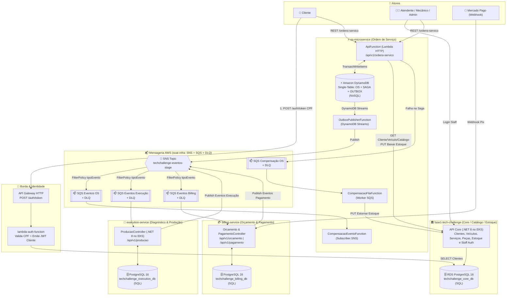
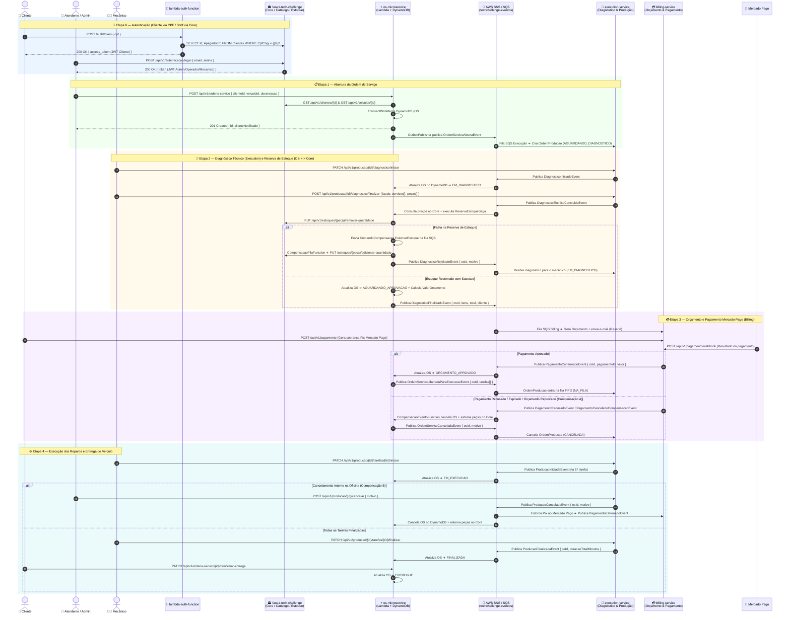

# 🗺️ Arquitetura Consolidada, Fluxo Completo, Contratos e Validação da Fase 4

Documento consolidado com as **decisões arquiteturais definidas** e a **validação contra os requisitos oficiais da Fase 4 (`FASE_4.md`)**:

1. **[`os-microservice`](../os-microservice/README.md)** é o microsserviço responsável por **Ordem de Serviço** (AWS Lambda .NET 8 + **DynamoDB NoSQL** + Transactional Outbox via DynamoDB Streams).
2. **[`fase1-tech-challenge`](../fase1-tech-challenge/README.md)** atua como **Core / Catálogo / Clientes / Veículos / Estoque / Autenticação Staff** (EKS + **PostgreSQL 16 RDS**).
3. **[`execution-service`](../execution-service/README.md)** é o microsserviço de **Diagnóstico Técnico e Fila/Execução de Produção** (EKS + **PostgreSQL 16 dedicado**).
4. **[`billing-service`](../billing-service/README.md)** é o microsserviço de **Orçamento e Pagamento Mercado Pago** (EKS + **PostgreSQL 16 dedicado**).
5. **[`lambda-auth-function`](../lambda-auth-function/README.md)** realiza a **Autenticação Serverless de Cliente por CPF** (API Gateway + Lambda).
6. **Mensageria Unificada:** **AWS SNS** (`techchallenge-eventos-<stage>`) + **AWS SQS** (filas por serviço com `FilterPolicy` por `tipoEvento` + DLQs), provisionada em produção via `soat-infra` e emulada localmente via **Floci + Floci UI**.
7. **[`shared`](./README.md)** centraliza a **execução local** ([`docker-compose.yml`](./docker-compose.yml) + Floci/Floci UI em [`01-init-aws.sh`](./floci/init/ready.d/01-init-aws.sh)) e o pacote [`Fiap.TechChallenge.Contracts`](./src/Fiap.TechChallenge.Contracts/Fiap.TechChallenge.Contracts.csproj) organizado em pastas por serviço.

---

## 1. Diagrama Geral da Arquitetura (AWS SNS/SQS + Poliglota SQL/NoSQL)

---

## 2. Diagrama de Sequência Completo da Aplicação (Ponta a Ponta)

---

## 3. Organização dos Contratos no Repositório [`shared`](./README.md)

Os contratos e a execução local estão centralizados em [`shared/`](./README.md), separados em pastas por serviço:

- **Comum ([`Common/`](./src/Fiap.TechChallenge.Contracts/Common/)):**
  - [`IntegrationEvent.cs`](./src/Fiap.TechChallenge.Contracts/Common/IntegrationEvent.cs) — Envelope base (`EventId`, `OsId`, `CorrelationId`, `OccurredAt`, `Version`, `TipoEvento`).
  - [`SnsMessageAttributes.cs`](./src/Fiap.TechChallenge.Contracts/Common/SnsMessageAttributes.cs) — Atributos padronizados do SNS (`tipoEvento`, `origem`, `idOrdemServico`).
- **Ordem de Serviço ([`OsService/`](./src/Fiap.TechChallenge.Contracts/OsService/)):**
  - [`OrdemServicoEvents.cs`](./src/Fiap.TechChallenge.Contracts/OsService/OrdemServicoEvents.cs) — `OrdemServicoAbertaEvent`, `DiagnosticoRejeitadoEvent`, `DiagnosticoFinalizadoEvent`, `OrdemServicoLiberadaParaExecucaoEvent`, `OrdemServicoCanceladaEvent`, `OrcamentoReprovadoEvent`, `PecasInsumoIncluidasEvent`, `StatusOrdemServicoAlteradoEvent`.
  - [`OrdemServicoCommands.cs`](./src/Fiap.TechChallenge.Contracts/OsService/OrdemServicoCommands.cs) — `ComandoCompensacaoContrato` (SQS).
  - [`OrdemServicoModels.cs`](./src/Fiap.TechChallenge.Contracts/OsService/OrdemServicoModels.cs) — `ClienteInfo`, `VeiculoInfo`, `TarefaInfo`, `ItemOrcamentoInfo`.
- **Execução e Produção ([`ExecutionService/`](./src/Fiap.TechChallenge.Contracts/ExecutionService/)):**
  - [`ExecutionEvents.cs`](./src/Fiap.TechChallenge.Contracts/ExecutionService/ExecutionEvents.cs) — `DiagnosticoIniciadoEvent`, `DiagnosticoTecnicoConcluidoEvent`, `ProducaoIniciadaEvent`, `ProducaoFinalizadaEvent`, `ProducaoCanceladaEvent`.
  - [`ExecutionModels.cs`](./src/Fiap.TechChallenge.Contracts/ExecutionService/ExecutionModels.cs) — `ServicoSugeridoInfo`, `PecaSugeridaInfo`.
- **Orçamento e Pagamento ([`BillingService/`](./src/Fiap.TechChallenge.Contracts/BillingService/)):**
  - [`BillingEvents.cs`](./src/Fiap.TechChallenge.Contracts/BillingService/BillingEvents.cs) — `OrcamentoGeradoEvent`, `PagamentoConfirmadoEvent`, `PagamentoCanceladoCompensacaoEvent`, `PagamentoRecusadoEvent`, `PagamentoEstornadoEvent`.
  - [`BillingModels.cs`](./src/Fiap.TechChallenge.Contracts/BillingService/BillingModels.cs) — `MetodoPagamentoContrato`, `StatusPagamentoContrato`, `MercadoPagoWebhookRequest`.
- **Core / Catálogo / Estoque ([`CoreService/`](./src/Fiap.TechChallenge.Contracts/CoreService/)):**
  - [`CoreCatalogoContracts.cs`](./src/Fiap.TechChallenge.Contracts/CoreService/CoreCatalogoContracts.cs) — `CoreApiRoutes`, `ClienteCatalogoDto`, `VeiculoCatalogoDto`, `ServicoCatalogoDto`, `PecaInsumoCatalogoDto`.
  - [`CoreEstoqueEvents.cs`](./src/Fiap.TechChallenge.Contracts/CoreService/CoreEstoqueEvents.cs) — `ReservaEstoqueFalhouEvent`.
- **Autenticação ([`AuthService/`](./src/Fiap.TechChallenge.Contracts/AuthService/)):**
  - [`AuthContracts.cs`](./src/Fiap.TechChallenge.Contracts/AuthService/AuthContracts.cs) — `JwtAuthConstants` (Issuer `TechChallenge`, Audience `techchallenge.com.br`, Roles `Administrador`, `Operador`, `Mecanico`), `AuthTokenRequest`, `AuthTokenResponse`.
- **Execução Local:**
  - [`docker-compose.yml`](./docker-compose.yml) (Floci + Floci UI + PostgreSQL por serviço) e [`01-init-aws.sh`](./floci/init/ready.d/01-init-aws.sh).

---

## 4. O Que Falta Ajustar em Cada Repositório (Segundo a Arquitetura Definida)

### 4.1. [`os-microservice`](../os-microservice/README.md) (Responsável pela OS)
- [ ] **Ouvir os eventos de avanço de status no SNS (`CompensacaoEventoFunction` / novo handler de eventos):**
  - Receber `DiagnosticoIniciadoEvent` ➔ mudar OS para `EM_DIAGNOSTICO`.
  - Receber `DiagnosticoTecnicoConcluidoEvent` ➔ consultar preços no Core (`CoreApiClient`), rodar `ReservaEstoqueSaga`, mudar OS para `AGUARDANDO_APROVACAO` e publicar `DiagnosticoFinalizadoEvent` (ou `DiagnosticoRejeitadoEvent` se falhar).
  - Receber `PagamentoConfirmadoEvent` ➔ mudar OS para `ORCAMENTO_APROVADO` e publicar `OrdemServicoLiberadaParaExecucaoEvent`.
  - Receber `ProducaoIniciadaEvent` ➔ mudar OS para `EM_EXECUCAO`.
  - Receber `ProducaoFinalizadaEvent` ➔ mudar OS para `FINALIZADA`.
  - Receber `ProducaoCanceladaEvent` ➔ cancelar OS e estornar peças no Core.
- [ ] **Enriquecer `OrdemServicoCriada` / publicar `OrdemServicoAbertaEvent`:** incluir `ClienteInfo` e `VeiculoInfo` no evento de abertura da OS para que o `execution-service` receba o snapshot do cliente/veículo sem consultar o banco do Core.
- [ ] **Desativar rotas REST de diagnóstico/execução diretas na Lambda** (`iniciar-diagnostico`, `finalizar-diagnostico`, `servicos/{id}/iniciar`, `servicos/{id}/finalizar` em [`OrdemServicoEndpoints.cs`](../os-microservice/src/OrdemServico.Lambda/Api/OrdemServicoEndpoints.cs)), pois agora são responsabilidade do `execution-service`.
- [ ] **Adicionar pipeline CI/CD** (`.github/workflows/`), Swagger/Postman, Dockerfile/K8s (ou documentar opção Serverless/K8s) e elevar cobertura de testes de `63.6%` para `>= 80%`.

### 4.2. [`fase1-tech-challenge`](../fase1-tech-challenge/README.md) (Responsável por Core / Catálogo / Estoque / Staff Auth)
- [x] **Remover [`OrdemServicoController.cs`](../fase1-tech-challenge/src/Fiap.TechChallenge.Api/Controllers/V1/OrdemServicoController.cs)** e código de aplicação legado de OS, delegando integralmente o domínio de OS para o `os-microservice`.
- [x] **Incluir a permissão/role `Mecanico` e usuário padrão no [`DatabaseSeed.cs`](../fase1-tech-challenge/src/Fiap.TechChallenge.Infrastructure/Data/Seed/DatabaseSeed.cs)** para permitir login de mecânicos (`mecanico@techchallenge.com` / `Mecanico@123`).
- [x] **Permitir que a role `Mecanico` consulte `GET /api/v1/servicos`, `GET /api/v1/pecas-insumos`, `GET /api/v1/veiculos`, `GET /api/v1/clientes` e `GET /api/v1/estoques`** nos controllers correspondentes.
- [x] **Compatibilizar `ClienteDto` (suporte a celular/telefone) e dados do veículo** consumidos pelo [`CoreApiClient.cs`](../os-microservice/src/OrdemServico.Lambda/Infrastructure/Http/CoreApiClient.cs) do `os-microservice`.

### 4.3. [`execution-service`](../execution-service/README.md) (Responsável por Diagnóstico e Execução)
- [x] **Substituído transporte RabbitMQ/LavinMQ por AWS SQS/SNS nativo:**
  - Implementado [`ExecutionSqsBackgroundWorker.cs`](../execution-service/src/Fiap.TechChallenge.Execution.Infrastructure/Messaging/ExecutionSqsBackgroundWorker.cs) consumindo da fila SQS `techchallenge-execucao-eventos-<stage>`.
  - Implementado [`AwsSnsEventPublisher.cs`](../execution-service/src/Fiap.TechChallenge.Execution.Infrastructure/Messaging/AwsSnsEventPublisher.cs) publicando eventos no tópico SNS `techchallenge-eventos-<stage>` com atributos de mensagem (`tipoEvento`).
  - LavinMQ completamente removido do ecossistema.
- [x] **Padronizar `Jwt:Issuer` e `Jwt:Audience` em [`JwtConfiguration.cs`](../execution-service/src/Fiap.TechChallenge.Execution.Api/Configurations/JwtConfiguration.cs)** para `TechChallenge` e `techchallenge.com.br` (iguais ao Core e `os-microservice`).
- [ ] **Adicionar K8s manifests (`k8s/`), CI/CD com SonarCloud (`.github/workflows/`), `coverlet.runsettings` (excluindo `Migrations`), OpenTelemetry e testes BDD (Reqnroll).**

### 4.4. [`billing-service`](../billing-service/README.md) (Responsável por Orçamento e Pagamento)
- [ ] **Responsabilidades e Contratos garantidos em [`shared/src/Fiap.TechChallenge.Contracts/BillingService/`](./src/Fiap.TechChallenge.Contracts/BillingService/):**
  - **Deve consumir da fila SQS (`techchallenge-billing-eventos-<stage>`):**
    - `DiagnosticoFinalizadoEvent` ➔ gera o `Orcamento` + cria cobrança Pix no Mercado Pago + envia e-mail ao cliente + publica `OrcamentoGeradoEvent`.
    - `ProducaoCanceladaEvent` ➔ executa estorno (refund) no Mercado Pago + publica `PagamentoEstornadoEvent`.
    - `OrdemServicoCanceladaEvent` ➔ cancela orçamento/cobrança pendente.
  - **Deve publicar no tópico SNS (`techchallenge-eventos-<stage>`):**
    - `PagamentoConfirmadoEvent` (com atributo `tipoEvento = PagamentoConfirmadoEvent`).
    - `PagamentoRecusadoEvent` / `PagamentoCanceladoCompensacaoEvent` (com atributo `tipoEvento = PagamentoRecusado` para acionar a compensação no `os-microservice`).
    - `PagamentoEstornadoEvent` (após estorno de pagamento).

### 4.5. [`lambda-auth-function`](../lambda-auth-function/README.md) (Responsável por Auth CPF)
- [ ] **Alinhar defaults de `JWT_ISSUER` (`TechChallenge`) e `JWT_AUDIENCE` (`techchallenge.com.br`)** em [`Function.cs`](../lambda-auth-function/src/Fiap.TechChallenge.LambdaAuth/Function.cs) para bater com o `os-microservice` e o `fase1-tech-challenge`.

---

## 5. Validação Contra os Requisitos Oficiais (`FASE_4.md`)

| Categoria (`FASE_4.md`) | Requisito Exigido | Status Atual | Evidência / O Que Falta |
| :--- | :--- | :---: | :--- |
| **1. Separação em Microsserviços** | Mínimo **3 microsserviços independentes**, cada um com repositório, infra e banco próprios | 🟡 **Parcial** | Temos **4 microsserviços de negócio** + **1 Lambda Auth** + **1 repo `shared`**: • `os-microservice` (OS) • `execution-service` (Diagnóstico & Produção) • `billing-service` (Orçamento & Pagamento) • `fase1-tech-challenge` (Core/Catálogo/Estoque) **Pendente:** desativar `OrdemServicoController` no Core e finalizar integração de eventos entre `os-microservice` e `execution-service` (`billing-service` está apenas com contratos definidos). |
| **2. Persistência Poliglota & Isolamento** | Banco próprio por serviço; **≥ 1 SQL** e **≥ 1 NoSQL**; nenhum serviço acessa banco de outro | 🟢 **Atendido (com 1 ressalva)** | • **NoSQL:** `os-microservice` usa **Amazon DynamoDB** (`techchallenge-ordem-servico-<stage>`). • **SQL:** `fase1-tech-challenge`, `execution-service` e `billing-service` usam bancos **PostgreSQL 16** isolados. ⚠️ **Ponto de atenção (linha 73 do `FASE_4.md`):** a `lambda-auth-function` faz `SELECT` direto no PostgreSQL do Core (`Clientes`). Como o requisito proíbe acesso direto ao banco de outro serviço, convém documentar que a Lambda Auth faz parte da fronteira do Core (Identity Provider do Core) ou fazê-la consultar um endpoint interno do Core. |
| **3. Comunicação entre Microsserviços** | APIs RESTful síncronas (quando necessário) + Mensageria assíncrona (SQS/SNS/RabbitMQ) | 🟢 **Atendido** | • **REST síncrono:** `os-microservice` consome catálogo e valida cliente/veículo no `fase1-tech-challenge` via [`CoreApiClient.cs`](../os-microservice/src/OrdemServico.Lambda/Infrastructure/Http/CoreApiClient.cs). • **Mensageria assíncrona:** 100% nativa AWS (SNS + SQS) no Floci/AWS. O `os-microservice` publica `OrdemServicoAbertaEvent` e `OrdemServicoLiberadaParaExecucaoEvent` no tópico SNS, o Floci roteia para a fila SQS e o `execution-service` consome de forma autônoma via [`ExecutionSqsBackgroundWorker.cs`](../execution-service/src/Fiap.TechChallenge.Execution.Infrastructure/Messaging/ExecutionSqsBackgroundWorker.cs). |
| **4. Saga Pattern** | Coordenar fluxo transacional da OS com rollback/compensação em caso de falha; documentar e justificar no README | 🟡 **Parcial** | • `os-microservice` já implementa e documenta **Saga Híbrida**: **Orquestrada** para reserva/estorno de estoque ([`ReservaEstoqueSaga.cs`](../os-microservice/src/OrdemServico.Lambda/Application/Saga/ReservaEstoqueSaga.cs) + [`CompensacaoFilaFunction.cs`](../os-microservice/src/OrdemServico.Lambda/Functions/CompensacaoFilaFunction.cs)) e **Coreografada** via SNS ([`CompensacaoEventoFunction.cs`](../os-microservice/src/OrdemServico.Lambda/Functions/CompensacaoEventoFunction.cs) + Transactional Outbox). • `execution-service` já possui consumers de compensação. **Pendente:** conectar os eventos do `execution-service` ao `os-microservice` via SNS/SQS. |
| **5. Testes Unitários & Cobertura ≥ 80%** | Testes unitários em todos os microsserviços com **cobertura mínima de 80%** por serviço | 🔴 **Pendente em 2 serviços** | Cobertura de linhas medida hoje (excluindo `Migrations`): • `lambda-auth-function`: **87.4%** (33 testes) ✅ • `fase1-tech-challenge`: **> 80%** (42 arquivos de teste + `coverlet.runsettings`) ✅ • `os-microservice`: **63.6%** (50 testes) ❌ — precisa subir para `>= 80%`. • `execution-service`: **56.4%** só com UnitTests (100 testes) — precisa unificar a coleta com os 11 IntegrationTests (ou testar `ProducaoController`/`Repository` em unit tests) e adicionar `coverlet.runsettings` excluindo `Migrations`. • `billing-service`: não compila no momento. |
| **6. Testes BDD** | Pelo menos **um fluxo completo testado com BDD** | 🟢 **Atendido** | Implementado projeto E2E BDD em [`shared/tests/Fiap.TechChallenge.E2ETests/`](./tests/Fiap.TechChallenge.E2ETests/) com Reqnroll 2.2 (.NET 8) em português (`pt-BR`). Cobre: 1. Ciclo completo de vida da OS (Abertura ➔ Diagnóstico ➔ Peças/Serviços ➔ Orçamento ➔ Produção ➔ Entrega). 2. Saga e Compensação de estoque. 3. Sanidade de APIs e contratos em ambiente Floci (DynamoDB/SNS/SQS). |
| **7. Qualidade de Código (SonarQube)** | Validação via **SonarQube** ou similar no CI | 🟡 **Parcial** | • `fase1-tech-challenge`: possui [`ci.yml`](../fase1-tech-challenge/.github/workflows/ci.yml) e [`sonar.yaml`](../fase1-tech-challenge/.github/workflows/sonar.yaml) com SonarCloud. • `os-microservice`, `execution-service` e `billing-service`: **não possuem** workflow do SonarQube/SonarCloud configurado. |
| **8. CI/CD Automatizado & Kubernetes** | Pipeline independente por microsserviço (Build, Testes, Qualidade, Deploy K8s) + Dockerfile + Manifestos K8s | 🔴 **Incompleto** | • `fase1-tech-challenge`: possui `Dockerfile`, `k8s/` e `.github/workflows/{ci.yml,cd.yaml,sonar.yaml}` ✅. • `os-microservice`: possui `Dockerfile` e container local funcional via compose; pode rodar tanto em container Docker/K8s quanto Serverless Lambda (`infra/template.yaml`). Falta `.github/workflows/` e `k8s/`. • `execution-service`: possui `Dockerfile`, mas **não possui** pasta `k8s/` nem `.github/workflows/`. • `billing-service`: **não possui** `Dockerfile`, `k8s/` nem `.github/workflows/`. |
| **9. Documentação, Swagger e Postman** | Arquitetura no README, evidências de cobertura e Swagger ou collection Postman atualizada | 🟡 **Parcial** | • `fase1-tech-challenge` e `lambda-auth-function`: possuem `docs/postman/` e Swagger. • `execution-service`: possui Swagger configurado em [`Program.cs`](../execution-service/src/Fiap.TechChallenge.Execution.Api/Program.cs), falta collection Postman. • `os-microservice`: **não possui** Swagger habilitado no [`Program.cs`](../os-microservice/src/OrdemServico.Lambda/Program.cs) nem pasta `docs/postman/`. |
| **10. Observabilidade** | Monitoramento e rastreamento de fluxos distribuídos (Fase 3) | 🟡 **Parcial** | • `fase1-tech-challenge`: stack completa (`OpenTelemetry`, `Prometheus`, `Loki`, `Tempo`, `Alertmanager`). • `os-microservice`: `CorrelationIdMiddleware`, logs JSON estruturados, AWS X-Ray ativo e alarmes CloudWatch em `infra/template.yaml`. • `execution-service`: possui `CorrelationIdMiddleware` e `/health/live` + `/health/ready`, mas ainda não configurou OpenTelemetry no `Program.cs`. |

