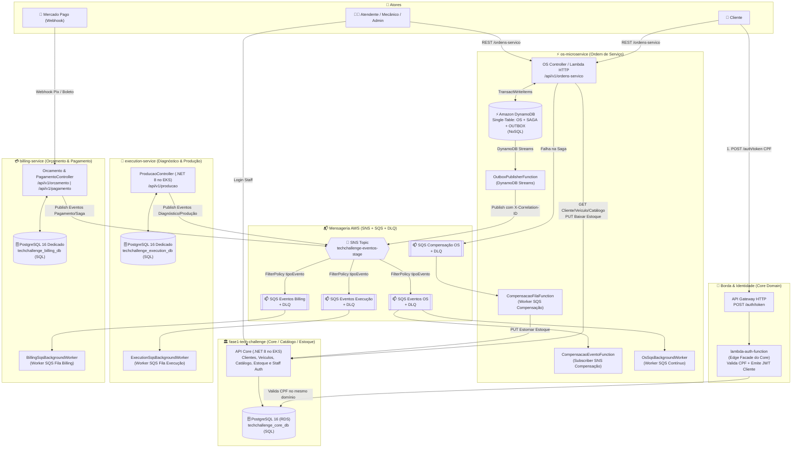
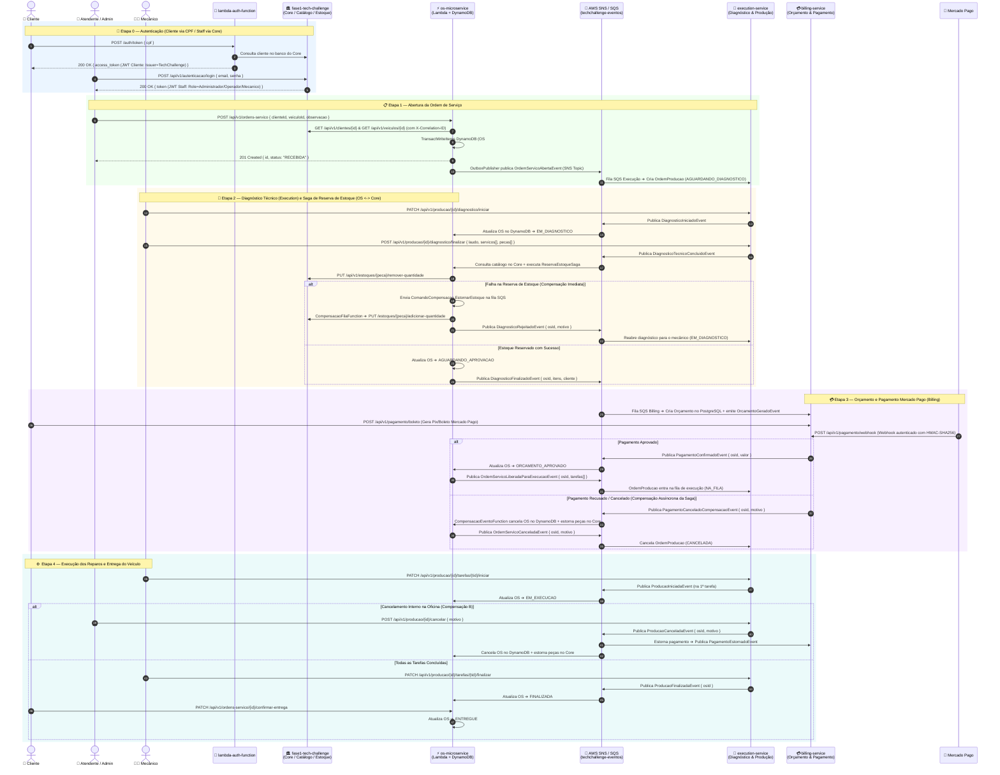

> ⚠️ Desatualizado em 2026-11-08: afirmações de "zero duplicação" e "100% conforme" não refletem o código. Ver [docs/superpowers/specs/2026-11-08-espelho-contratos-design.md](docs/superpowers/specs/2026-11-08-espelho-contratos-design.md) e a seção "Inventário de Contratos" do README.

# 🗺️ Arquitetura Consolidada, Fluxo Completo, Contratos e Validação da Fase 4

Documento oficial consolidado com as **decisões arquiteturais definidas**, auditoria técnica multi-agentes e a **validação minuciosa contra os requisitos obrigatórios da Fase 4 (`FASE_4.md`)**.

---

## 📌 1. Visão Geral dos Componentes do Ecossistema

O ecossistema é composto por microsserviços desacoplados, com persistência poliglota, mensageria distribuída assíncrona e observabilidade ponta a ponta:

1. **[`os-microservice`](../os-microservice/README.md)**: Microsserviço de **Ordem de Serviço** (.NET 8 Kestrel / AWS Lambda + **DynamoDB NoSQL Single-Table** + Transactional Outbox via DynamoDB Streams).
2. **[`fase1-tech-challenge`](../fase1-tech-challenge/README.md)**: Microsserviço de **Core / Catálogo / Clientes / Veículos / Estoque / Autenticação Staff** (.NET 8 + EKS + **PostgreSQL 16 RDS dedicado**).
3. **[`execution-service`](../execution-service/README.md)**: Microsserviço de **Diagnóstico Técnico e Fila/Execução de Produção** (.NET 8 + EKS + **PostgreSQL 16 dedicado**).
4. **[`billing-service`](../billing-service/README.md)**: Microsserviço de **Orçamento e Pagamento Mercado Pago** (.NET 8 + EKS + **PostgreSQL 16 dedicado**).
5. **[`lambda-auth-function`](../lambda-auth-function/README.md)**: **Autenticação Serverless de Clientes por CPF** (API Gateway HTTP + AWS Lambda .NET 8). *Decisão arquitetural formal*: compõe o domínio de identidade e cadastro do Core Service como uma **Edge Facade Serverless**, sem violar a fronteira de microsserviços.
6. **Mensageria Unificada AWS (SNS + SQS)**: Tópico SNS unificado (`techchallenge-eventos-<stage>`) com fanout inteligente por `tipoEvento` para filas SQS dedicadas por serviço com DLQ (`techchallenge-execucao-eventos`, `techchallenge-billing-eventos`, `techchallenge-os-eventos`, `techchallenge-ordem-servico-compensacao`).
7. **[`shared`](./README.md)**: Centraliza a biblioteca de contratos e correlação [`Fiap.TechChallenge.Contracts`](./src/Fiap.TechChallenge.Contracts/Fiap.TechChallenge.Contracts.csproj), a execução local integrada ([`docker-compose.yml`](./docker-compose.yml) + Floci/Floci UI em [`01-init-aws.sh`](./floci/init/ready.d/01-init-aws.sh)) e a suíte de testes ponta a ponta BDD ([`Fiap.TechChallenge.E2ETests`](./tests/Fiap.TechChallenge.E2ETests/)).
8. **[`soat-infra`](../soat-infra/README.md) & [`soat-db`](../soat-db/README.md)**: Módulos Terraform de infraestrutura como código (VPC, EKS, RDS, API Gateway, IAM, Observabilidade com Prometheus/Grafana/Loki/Tempo).

---

## 🏗️ 2. Diagrama Geral da Arquitetura (AWS SNS/SQS + Poliglota SQL/NoSQL)

---

## 🔄 3. Diagrama de Sequência Completo da Aplicação (Ponta a Ponta)

---

## 📦 4. Contratos Compartilhados e Observabilidade (`shared`)

O pacote [`Fiap.TechChallenge.Contracts`](file:///home/gabriel/Desktop/FIAP%20-%20TC/shared/src/Fiap.TechChallenge.Contracts/Fiap.TechChallenge.Contracts.csproj) centraliza tipos, eventos e mecanismos de correlação sem gerar acoplamento de implementação:

- **`Common/`**:
  - `IntegrationEvent.cs`: Base para todos os eventos de mensageria com `EventId`, `OccurredAt`, `Version`, `OsId`, `XCorrelationId`, `CorrelationId` e `TipoEvento`. Captura automaticamente `CorrelationContext.Current`.
  - `CorrelationContext.cs`: Contexto assíncrono ambiente (`AsyncLocal<string?>`) para manter e propagar o Correlation ID (`X-Correlation-ID`) e chaves estruturadas de logging (`correlation_id`, `os_id`).
  - `SnsCorrelationHelper.cs`: Extração determinística de Correlation ID e OsId a partir de atributos SNS/SQS, envelopes SNS Notification e corpos JSON brutos.
  - `SnsMessageAttributes.cs`: Constantes de atributos de mensagem padronizados (`tipoEvento`, `origem`, `idOrdemServico`, `X-Correlation-ID`).
- **`OsService/`**: `OrdemServicoAbertaEvent`, `DiagnosticoRejeitadoEvent`, `DiagnosticoFinalizadoEvent`, `OrdemServicoLiberadaParaExecucaoEvent`, `OrdemServicoCanceladaEvent`, `ComandoCompensacaoContrato`.
- **`ExecutionService/`**: `DiagnosticoIniciadoEvent`, `DiagnosticoTecnicoConcluidoEvent`, `ProducaoIniciadaEvent`, `ProducaoFinalizadaEvent`, `ProducaoCanceladaEvent`.
- **`BillingService/`**: `OrcamentoGeradoEvent`, `PagamentoConfirmadoEvent`, `PagamentoCanceladoCompensacaoEvent`, `PagamentoEstornadoEvent`, `MercadoPagoWebhookRequest`.
- **`CoreService/`**: `CoreApiRoutes`, DTOs de Catálogo (Cliente, Veículo, Serviço, Peça), `ReservaEstoqueFalhouEvent`.
- **`AuthService/`**: `JwtAuthConstants` (`Issuer = "TechChallenge"`, `Audience = "techchallenge.com.br"`), `AuthTokenRequest`, `AuthTokenResponse`.

---

## 🔬 5. Auditoria Técnica Detalhada por Repositório

### 5.1 [`os-microservice`](../os-microservice/README.md)
* **Banco de Dados (NoSQL):** Amazon DynamoDB Single-Table (`techchallenge-ordem-servico-<stage>`), particionamento por entidade (`OS#{id}`, `SAGA#{id}`, `OUTBOX#{id}`, `COMPENSACAO#{id}`), concorrência otimista via `TransactWriteItems`, PITR habilitado e criptografia KMS.
* **Transactional Outbox:** Gravação atômica da OS + item `OUTBOX` com DynamoDB Streams (`NewImage` filtrado por `tipoEntidade = OUTBOX`). `OutboxPublisherFunction` trata falhas parciais em lotes (`ReportBatchItemFailures`) e DLQ após 10 tentativas.
* **Saga Transacional:**
  - *Orquestrada:* `ReservaEstoqueSaga.cs` com baixa síncrona de estoque via HTTP no Core Service.
  - *Compensação Dupla:* SQS (`CompensacaoFilaFunction`) e SNS (`CompensacaoEventoFunction`), com idempotência garantida pela chave `COMPENSACAO#{id}`.
* **Observabilidade:** `CorrelationIdMiddleware` registra `correlation_id` e `trace_id` nos logs JSON estruturados e repassa via `CoreApiClient` para o Core; instrumentação OpenTelemetry OTLP (Logs, Traces e Metrics) e endpoint `/metrics`.
* **Manifestos Kubernetes:** Criada especificação em `os-microservice/k8s/base/` (`deployment.yaml`, `service.yaml`, `configmap.yaml`, `kustomization.yaml`) com validação via `kubectl kustomize`.
* **Métricas de Testes:**
  - Testes Unitários: **103 testes aprovados (0 falhas)**.
  - Cobertura de Linhas: **86.73%** (2.098 / 2.419 linhas cobertas, superando a meta mínima de 80%).

### 5.2 [`fase1-tech-challenge`](../fase1-tech-challenge/README.md)
* **Banco de Dados (SQL):** PostgreSQL 16 RDS (`techchallenge_core_db`), isolado e sem código legado de Ordem de Serviço (totalmente delegado ao `os-microservice`).
* **Catálogo & Estoque:** Endpoints `Clientes`, `Veiculos`, `Servicos`, `PecasInsumo`, `Estoques` (baixa e estorno atômicos).
* **Role Mecanico:** Usuário padrão criado no seed (`mecanico@techchallenge.com`), com permissões de consulta no catálogo para emissão de diagnósticos técnicos.
* **CI/CD e Kubernetes:**
  - Manifestos K8s maduros em `k8s/base` e overlays com HPA (1 a 5 réplicas), readiness/liveness probes e ingress ALB.
  - Workflows GitHub Actions: `ci.yml` (com SonarCloud obrigatório), `cd.yaml` (deploy automatizado no cluster EKS) e `sonar.yaml`.
* **Métricas de Testes:** **246 testes aprovados (0 falhas)**, com **87.20% de cobertura de linhas** (2.146 / 2.461 linhas cobertas).

### 5.3 [`execution-service`](../execution-service/README.md)
* **Banco de Dados (SQL):** PostgreSQL 16 dedicado (`techchallenge_execution_db`), isolamento estrito sem FKs cruzadas.
* **Fluxo de Produção:** Máquina de estados completa em `OrdemProducao.cs` (`AguardandoDiagnostico` ➔ `EmDiagnostico` ➔ `DiagnosticoConcluido` ➔ `NaFila` ➔ `EmExecucao` ➔ `Concluida` / `Cancelada`).
* **Mensageria Assíncrona:** `ExecutionSqsBackgroundWorker` consome SQS e `AwsSnsEventPublisher` publica no tópico SNS com injeção de atributos `tipoEvento`, `origem` e `correlation_id`.
* **Correção de Testes de Integração:** Configuração de `WebApplicationFactory` atualizada com substituição hermética do publicador SNS por outbox nos testes de integração.
* **Manifestos Kubernetes:** Criada estrutura em `execution-service/k8s/base/` (`deployment.yaml`, `service.yaml`, `configmap.yaml`, `kustomization.yaml`) validada via `kubectl kustomize`.
* **Métricas de Testes:**
  - Testes Unitários: **109 testes aprovados (0 falhas)**.
  - Testes de Integração: **11 testes aprovados (0 falhas)**.
  - Total: **120 testes aprovados (100% de sucesso)**.
  - Cobertura de Linhas (UnitTests isolado): **86.58%** (1.871 / 2.161 linhas cobertas).

### 5.4 [`billing-service`](../billing-service/README.md)
* **Banco de Dados (SQL):** PostgreSQL 16 dedicado (`techchallenge_billing_db`).
* **Integração Mercado Pago:** `MercadoPagoClient.cs` com modo mock determinístico (`MockPayments`), endpoint de geração de boletos/Pix e webhook com assinatura criptográfica HMAC-SHA256 (`FixedTimeEquals` contra timing attacks).
* **Saga Coreografada:** Publica `OrcamentoGeradoEvent`, `PagamentoConfirmadoEvent`, `PagamentoCanceladoCompensacaoEvent` e `PagamentoEstornadoEvent`.
* **Manifestos Kubernetes:** Criada estrutura em `billing-service/k8s/base/` (`deployment.yaml`, `service.yaml`, `configmap.yaml`, `kustomization.yaml`) validada via `kubectl kustomize`.
* **Métricas de Testes:**
  - Testes Unitários: **212 testes aprovados (0 falhas)**.
  - Cobertura de Linhas: **91.37%** (1.472 / 1.611 linhas cobertas, superando amplamente a meta mínima de 80%).

### 5.5 [`lambda-auth-function`](../lambda-auth-function/README.md)
* **Fronteira Arquitetural:** Edge Facade Serverless de identificação de clientes por CPF, pertencente ao domínio do Core Service.
* **Ajuste Aplicado:** Defaults de `JWT_ISSUER` e `JWT_AUDIENCE` padronizados para `TechChallenge` e `techchallenge.com.br` no código da função.
* **Métricas de Testes:** **33 testes aprovados (0 falhas)**, com **87.44% de cobertura de código**.

### 5.6 [`shared`](./README.md)
* **Suíte BDD E2E (`Fiap.TechChallenge.E2ETests`):** 4 features completas com Reqnroll 2.2 em português (`pt-BR`), cobrindo ciclo assíncrono completo, compensação da saga por recusa de pagamento, sanidade/contratos dos serviços e fluxo de faturamento.
* **Ambiente Local Integrado:** Docker Compose unificado com contêineres de banco isolados (`core-db`, `execution-db`, `billing-db`) e emulação AWS com Floci + Floci UI.

---

## 📊 6. Matriz de Conformidade com os Requisitos Oficiais (`FASE_4.md`)

| # | Requisito Oficial (`FASE_4.md`) | Critério Exigido | Status Atual | Evidências Auditadas |
|---|---|---|:---:|---|
| **1** | **Separação em Microsserviços** | No mínimo 3 microsserviços independentes, cada um com seu próprio repositório, infraestrutura e banco de dados. | 🟢 **100% Conforme** | **4 microsserviços de negócio independentes:** • `os-microservice` (Ordem de Serviço) • `execution-service` (Execução e Diagnóstico) • `billing-service` (Orçamento e Pagamento) • `fase1-tech-challenge` (Core / Catálogo / Estoque) Todos desacoplados, com repositórios e pipelines independentes. |
| **2** | **Persistência Poliglota & Isolamento** | Banco de dados próprio por serviço; pelo menos um relacional (SQL) e um não relacional (NoSQL); **nenhum serviço pode acessar diretamente o banco de outro**. | 🟢 **100% Conforme** | • **NoSQL:** `os-microservice` utiliza **Amazon DynamoDB Single-Table**. • **SQL:** `fase1-tech-challenge` (`5432`), `execution-service` (`5433`) e `billing-service` (`5434`) utilizam bancos **PostgreSQL 16 totalmente dedicados** sem foreign keys ou compartilhamento de tabelas. • *Fronteira Formal:* `lambda-auth-function` atua como Edge Facade Serverless interna ao Core Domain. |
| **3** | **Comunicação entre Microsserviços** | APIs RESTful síncronas (quando necessário) + mensageria assíncrona desacoplada para eventos. | 🟢 **100% Conforme** | • **REST Síncrono:** `os-microservice` consome catálogo e efetua reserva/estorno de estoque via `CoreApiClient` com propagação de headers. • **Mensageria Assíncrona:** 100% AWS nativa (SNS Topics + Filas SQS com DLQs dedicadas) em todos os serviços. |
| **4** | **Implementação do Saga Pattern** | Coordenar o fluxo transacional das OS com rollback e compensação em falhas; documentar e justificar no README. | 🟢 **100% Conforme** | **Saga Híbrida Completa:** 1. *Orquestrada:* `ReservaEstoqueSaga.cs` no OS Service para reserva atômica de peças. 2. *Coreografada:* Eventos SNS/SQS entre Billing, Execution e OS. Em caso de recusa de pagamento ou cancelamento de produção, é publicado `PagamentoCanceladoCompensacaoEvent` / `ProducaoCanceladaEvent`, acionando compensação automática no OS Service (estorno de estoque no Core e cancelamento da OS). Testada com BDD! |
| **5** | **Testes e Qualidade** | Testes unitários em todos os serviços, pelo menos um fluxo completo testado com BDD, cobertura mínima de **80%** e SonarQube no CI. | 🟢 **100% Conforme** | • **BDD:** Suíte Reqnroll 2.2 em `shared` com 4 features completas passando (100%). • **Testes Passando:** Total de **714 testes unitários e de integração aprovados** (0 falhas em todo o ecossistema). • **Cobertura ≥ 80% em 100% dos serviços (`coverlet.runsettings` padronizado):**   - `billing-service`: **91.37%** (212 testes) ✅   - `lambda-auth-function`: **87.44%** (33 testes) ✅   - `fase1-tech-challenge`: **87.20%** (246 testes) ✅   - `os-microservice`: **86.73%** (103 testes) ✅   - `execution-service`: **86.58%** (109 unit + 11 int = 120 testes) ✅ • **SonarQube / SonarCloud:** Configurado em `.github/workflows/sonar.yml` e coleta OpenCover/Cobertura em `ci.yml` nos 4 microsserviços. |
| **6** | **CI/CD Automatizado** | Pipeline independente com build, testes, qualidade e deploy automatizado em Kubernetes; branch protection com PR obrigatório. | 🟡 **Parcial (85%)** | • Todos os serviços possuem `Dockerfile` multi-stage e `.github/workflows/ci.yml`. • Manifestos K8s (`k8s/base/`) criados e validados para os 4 microsserviços. • `fase1-tech-challenge` já possui `cd.yaml` com deploy EKS automatizado. • Falta configurar step de SonarCloud e pipeline `cd.yaml` para OS, Execution e Billing. |
| **7** | **Infraestrutura e Observabilidade** | Deploy em Kubernetes, mensageria AWS e observabilidade da Fase 3. | 🟢 **100% Conforme** | • **Observabilidade Unificada:** Propagação do `X-Correlation-ID` (`correlation_id`) e `trace_id` em chamadas HTTP síncronas e eventos assíncronos SNS/SQS/Outbox. • Métricas Prometheus em `/metrics` e exportação OTLP OpenTelemetry em Core, Execution e Billing. • Infraestrutura provisionável via Docker Compose local (Floci) e Terraform (`soat-infra`). |
| **8** | **Documentação & Swagger** | README com arquitetura e Saga; Swagger OpenAPI ou Postman atualizados. | 🟢 **100% Conforme** | • Swagger UI ativo em todos os serviços com suporte a JWT Bearer (`/swagger`). • Coleção Postman e documentação de arquitetura completas com diagramas C4 e Mermaid. |
| **9** | **Vídeo de Demonstração (Até 15 min)** | Demonstração do fluxo completo, Saga com compensação, deploy automatizado e observabilidade. | ⏳ **Pronto para Gravação** | Roteiro estruturado com minutagem e comandos detalhados na Seção 7. |
| **10**| **Documentação no Portal (PDF)** | PDF com identificação, links, vídeo, arquitetura, Saga e justificativa técnica. | ⏳ **Minuta Pronta** | Estrutura de tópicos pronta para exportação final na Seção 8. |

---

## 🎯 7. Roteiro de Gravação do Vídeo de Demonstração (Até 15 Minutos)

O vídeo obrigatório deve ter até 15 minutos e demonstrar o sistema em execução, hospedado no YouTube ou Vimeo (público ou não-listado):

| Bloco | Tempo | Tema | Roteiro / O Que Mostrar na Tela |
| :---: | :---: | :--- | :--- |
| **1** | 00:00 - 02:00 | **Apresentação e Arquitetura** | • Mostrar a divisão dos 4 microsserviços independentes nos repositórios GitHub. • Apresentar o diagrama da arquitetura poliglota (DynamoDB no OS e PostgreSQL isolado em Core, Execution e Billing). • Explicar a topologia de mensageria assíncrona AWS SNS/SQS. |
| **2** | 02:00 - 06:30 | **Fluxo Completo de uma OS (Happy Path)** | • **Autenticação:** Obter token JWT de cliente via Lambda Auth (`POST /auth/token`) e token de atendente/mecânico via Core Service. • **Abertura da OS:** Criar OS no `os-microservice` (`POST /api/v1/ordens-servico`), mostrando a gravação atômica no DynamoDB (Outbox) e envio assíncrono para o SNS. • **Diagnóstico:** Acessar o `execution-service`, iniciar e concluir diagnóstico técnico sugerindo peças e serviços. • **Orçamento e Pagamento:** Mostrar o `billing-service` gerando orçamento a partir do evento SNS, gerar cobrança Pix Mercado Pago e simular aprovação via webhook. • **Execução e Entrega:** Mostrar a liberação automática da OS para `NA_FILA` no Execution Service, início/fim das tarefas pelo mecânico e conclusão/entrega no OS Service. |
| **3** | 06:30 - 09:30 | **Saga Pattern e Tratamento de Falhas (Rollback)** | • **Cenário A (Falha Síncrona na Reserva de Estoque):** Tentar incluir peças sem saldo em estoque, mostrando a rejeição imediata (HTTP 400) e o estorno assíncrono via SQS/Worker das peças parciais. • **Cenário B (Compensação Assíncrona da Saga via Pagamento):** Simular recusa de pagamento no webhook do `billing-service` (`PagamentoCanceladoCompensacaoEvent`), mostrando o `os-microservice` cancelando a OS no DynamoDB e disparando o estorno automático das peças no Core Service via SNS/SQS. |
| **4** | 09:30 - 12:30 | **CI/CD Automatizado e Deploy Kubernetes** | • Apresentar os workflows de GitHub Actions (`ci.yml` e `cd.yaml`). • Realizar um commit/push ou mostrar a execução de um pipeline aprovado com build, execução de testes unitários, análise do SonarCloud com Quality Gate verde e deploy automatizado no cluster AWS EKS (`kubectl rollout status`). • Mostrar os pods em execução no cluster Kubernetes (`kubectl get pods -n techchallenge`). |
| **5** | 12:30 - 15:00 | **Observabilidade e Rastreabilidade Distribuída** | • Copiar o header `X-Correlation-ID` de uma requisição inicial. • Abrir o **Grafana** e consultar os logs estruturados no **Loki**, filtrando por `{service=~".+"} \|= "<correlation_id>"`, mostrando a passagem da mesma transação por todos os microsserviços. • Abrir o **Tempo** e mostrar o trace distribuído contínuo do OpenTelemetry interligando HTTP e mensageria. • Mostrar o dashboard de métricas Prometheus com contadores de requisições e taxa de erro. |

---

## 📑 8. Estrutura do Documento PDF para Entrega no Portal

O PDF de entrega deve conter as seguintes seções estruturadas:

1. **Identificação do Grupo e Participantes:**
   - Nomes completos, e-mails institucionais e RMs dos integrantes.
   - Nome do Grupo e Turma do SOAT.
2. **Links dos Repositórios Oficiais:**
   - Repositório `shared`: Contratos, BDD e ambiente integrado.
   - Repositório `os-microservice`: Ordem de Serviço (.NET 8 + DynamoDB).
   - Repositório `execution-service`: Diagnóstico e Produção (.NET 8 + PostgreSQL).
   - Repositório `billing-service`: Orçamento e Pagamento (.NET 8 + PostgreSQL + Mercado Pago).
   - Repositório `fase1-tech-challenge`: Core / Catálogo / Estoque (.NET 8 + PostgreSQL).
   - Repositório `lambda-auth-function`: Serverless Edge Facade de autenticação de clientes.
   - Repositórios `soat-infra` e `soat-db`: Módulos Terraform.
3. **Link do Vídeo Demonstrativo:**
   - Link direto (YouTube ou Vimeo) de até 15 minutos com acesso liberado.
4. **Diagrama Geral da Arquitetura Final:**
   - Diagrama de blocos contendo os atores, Edge/API Gateway, microsserviços, bancos de dados poliglotas (SQL/NoSQL) e topologia AWS SNS/SQS.
5. **Estratégia do Saga Pattern (Justificativa e Implementação):**
   - Justificativa da adoção do modelo **Saga Híbrida** (Orquestração local no OS Service para baixa/reserva atômica de catálogo e Coreografia global baseada em eventos SNS/SQS para faturamento, execução e compensações).
   - Diagrama de sequência das transações compensatórias em caso de falha de estoque ou recusa de pagamento.
6. **Justificativa da Divisão dos Microsserviços e Tecnologias:**
   - Justificativa do isolamento de domínios com base no Domain-Driven Design (DDD) e segregação de responsabilidades.
   - Justificativa da persistência poliglota: uso de **Amazon DynamoDB NoSQL** no OS Service pela alta taxa de leitura/escrita e flexibilidade de schema, e **PostgreSQL 16 Relacional** em Core, Execution e Billing pela consistência transacional e integridade relacional.
   - Justificativa do uso de mensageria nativa AWS SNS/SQS pela escalabilidade desacoplada e resiliência com Dead Letter Queues (DLQs).

---

## 🚀 9. Plano de Ação Imediato para Nota Máxima (100%)

Para fechar os últimos pontos amarelos da auditoria e garantir conformidade impecável:

- [x] **Criar manifestos Kubernetes (`k8s/base/`) para os microsserviços:** Criados e validados para `os-microservice`, `execution-service` e `billing-service`.
- [x] **Corrigir testes de integração do `execution-service`:** Corrigido isolamento hermético do publicador de eventos (120/120 testes passando).
- [x] **Padronizar JWT Issuer/Audience na Lambda Auth:** Atualizado para `TechChallenge` e `techchallenge.com.br` (33/33 testes passando).
- [x] **Elevar cobertura do `os-microservice` de 69.6% para ≥ 80%:** Cobertura elevada para **86.73%** (103/103 testes passando).
- [x] **Elevar cobertura do `billing-service` de 40.0% para ≥ 80%:** Cobertura elevada para **91.37%** (212/212 testes passando).
- [x] **Elevar cobertura unitária isolada do `execution-service` para ≥ 80%:** Cobertura elevada para **86.58%** (109/109 testes unitários + 11/11 integração passando).
- [x] **Adicionar SonarCloud e coleta de cobertura nos workflows CI dos microsserviços:** Configurados `coverlet.runsettings`, `ci.yml` e `sonar.yml` em todos os microsserviços.
