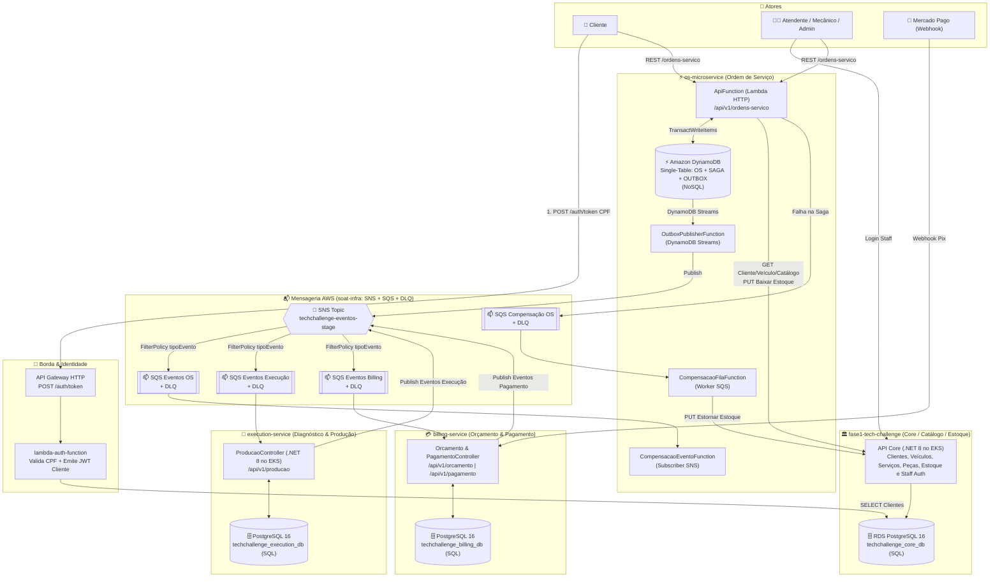
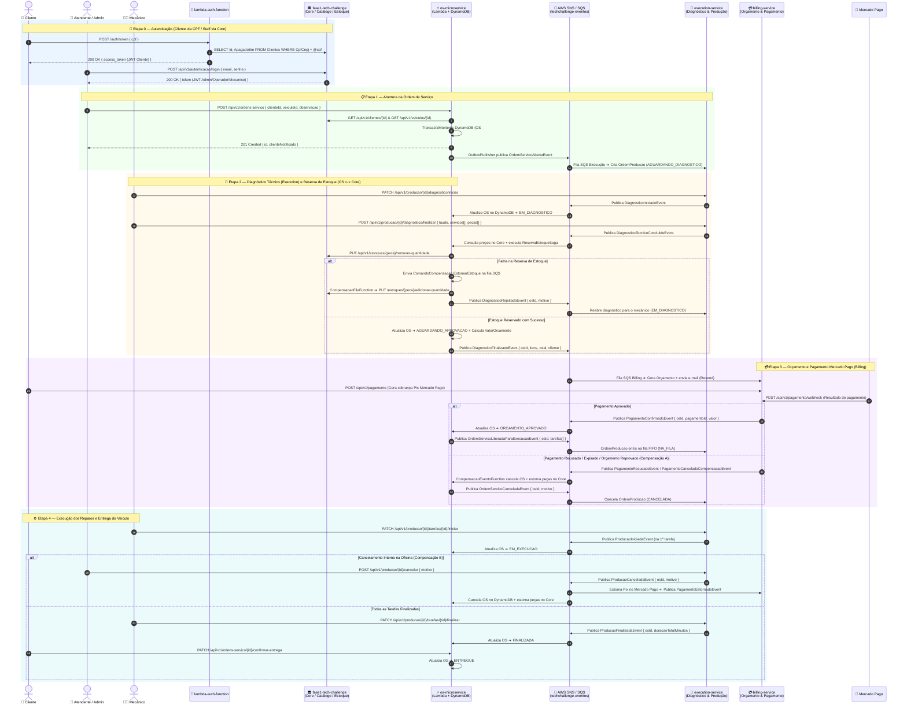

# 🗺️ Arquitetura Consolidada, Fluxo Completo, Contratos e Validação da Fase 4

Documento consolidado com as **decisões arquiteturais definidas** e a **validação contra os requisitos oficiais da Fase 4 (`FASE_4.md`)**:

1. **[`os-microservice`](../os-microservice/README.md)** é o microsserviço responsável por **Ordem de Serviço** (AWS Lambda .NET 8 + **DynamoDB NoSQL** + Transactional Outbox via DynamoDB Streams).
2. **[`fase1-tech-challenge`](../fase1-tech-challenge/README.md)** atua como **Core / Catálogo / Clientes / Veículos / Estoque / Autenticação Staff** (EKS + **PostgreSQL 16 RDS**).
3. **[`execution-service`](../execution-service/README.md)** é o microsserviço de **Diagnóstico Técnico e Fila/Execução de Produção** (EKS + **PostgreSQL 16 dedicado**).
4. **[`billing-service`](../billing-service/README.md)** é o microsserviço de **Orçamento e Pagamento Mercado Pago** (EKS + **PostgreSQL 16 dedicado**).
5. **[`lambda-auth-function`](../lambda-auth-function/README.md)** realiza a **Autenticação Serverless de Cliente por CPF** (API Gateway + Lambda).
6. **Mensageria Unificada:** **AWS SNS** (`techchallenge-eventos-<stage>`) + **AWS SQS** (filas por serviço com `FilterPolicy` por `tipoEvento` + DLQs), provisionada em produção via `soat-infra` e emulada localmente via **Floci + Floci UI**.
7. **[`shared`](./README.md)** centraliza a **execução local** ([`docker-compose.yml`](./docker-compose.yml) + Floci/Floci UI em [`01-init-aws.sh`](./floci/init/ready.d/01-init-aws.sh)) e o pacote [`Fiap.TechChallenge.Contracts`](./src/Fiap.TechChallenge.Contracts/Fiap.TechChallenge.Contracts.csproj) organizado em pastas por serviço.

---

## 1. Diagrama Geral da Arquitetura (AWS SNS/SQS + Poliglota SQL/NoSQL)

---

## 2. Diagrama de Sequência Completo da Aplicação (Ponta a Ponta)

---

## 3. Organização dos Contratos no Repositório [`shared`](./README.md)

Os contratos e a execução local estão centralizados em [`shared/`](./README.md), separados em pastas por serviço:

- **Comum ([`Common/`](./src/Fiap.TechChallenge.Contracts/Common/)):**
  - [`IntegrationEvent.cs`](./src/Fiap.TechChallenge.Contracts/Common/IntegrationEvent.cs) — Envelope base (`EventId`, `OsId`, `CorrelationId`, `OccurredAt`, `Version`, `TipoEvento`).
  - [`SnsMessageAttributes.cs`](./src/Fiap.TechChallenge.Contracts/Common/SnsMessageAttributes.cs) — Atributos padronizados do SNS (`tipoEvento`, `origem`, `idOrdemServico`).
- **Ordem de Serviço ([`OsService/`](./src/Fiap.TechChallenge.Contracts/OsService/)):**
  - [`OrdemServicoEvents.cs`](./src/Fiap.TechChallenge.Contracts/OsService/OrdemServicoEvents.cs) — `OrdemServicoAbertaEvent`, `DiagnosticoRejeitadoEvent`, `DiagnosticoFinalizadoEvent`, `OrdemServicoLiberadaParaExecucaoEvent`, `OrdemServicoCanceladaEvent`, `OrcamentoReprovadoEvent`, `PecasInsumoIncluidasEvent`, `StatusOrdemServicoAlteradoEvent`.
  - [`OrdemServicoCommands.cs`](./src/Fiap.TechChallenge.Contracts/OsService/OrdemServicoCommands.cs) — `ComandoCompensacaoContrato` (SQS).
  - [`OrdemServicoModels.cs`](./src/Fiap.TechChallenge.Contracts/OsService/OrdemServicoModels.cs) — `ClienteInfo`, `VeiculoInfo`, `TarefaInfo`, `ItemOrcamentoInfo`.
- **Execução e Produção ([`ExecutionService/`](./src/Fiap.TechChallenge.Contracts/ExecutionService/)):**
  - [`ExecutionEvents.cs`](./src/Fiap.TechChallenge.Contracts/ExecutionService/ExecutionEvents.cs) — `DiagnosticoIniciadoEvent`, `DiagnosticoTecnicoConcluidoEvent`, `ProducaoIniciadaEvent`, `ProducaoFinalizadaEvent`, `ProducaoCanceladaEvent`.
  - [`ExecutionModels.cs`](./src/Fiap.TechChallenge.Contracts/ExecutionService/ExecutionModels.cs) — `ServicoSugeridoInfo`, `PecaSugeridaInfo`.
- **Orçamento e Pagamento ([`BillingService/`](./src/Fiap.TechChallenge.Contracts/BillingService/)):**
  - [`BillingEvents.cs`](./src/Fiap.TechChallenge.Contracts/BillingService/BillingEvents.cs) — `OrcamentoGeradoEvent`, `PagamentoConfirmadoEvent`, `PagamentoCanceladoCompensacaoEvent`, `PagamentoRecusadoEvent`, `PagamentoEstornadoEvent`.
  - [`BillingModels.cs`](./src/Fiap.TechChallenge.Contracts/BillingService/BillingModels.cs) — `MetodoPagamentoContrato`, `StatusPagamentoContrato`, `MercadoPagoWebhookRequest`.
- **Core / Catálogo / Estoque ([`CoreService/`](./src/Fiap.TechChallenge.Contracts/CoreService/)):**
  - [`CoreCatalogoContracts.cs`](./src/Fiap.TechChallenge.Contracts/CoreService/CoreCatalogoContracts.cs) — `CoreApiRoutes`, `ClienteCatalogoDto`, `VeiculoCatalogoDto`, `ServicoCatalogoDto`, `PecaInsumoCatalogoDto`.
  - [`CoreEstoqueEvents.cs`](./src/Fiap.TechChallenge.Contracts/CoreService/CoreEstoqueEvents.cs) — `ReservaEstoqueFalhouEvent`.
- **Autenticação ([`AuthService/`](./src/Fiap.TechChallenge.Contracts/AuthService/)):**
  - [`AuthContracts.cs`](./src/Fiap.TechChallenge.Contracts/AuthService/AuthContracts.cs) — `JwtAuthConstants` (Issuer `TechChallenge`, Audience `techchallenge.com.br`, Roles `Administrador`, `Operador`, `Mecanico`), `AuthTokenRequest`, `AuthTokenResponse`.
- **Execução Local:**
  - [`docker-compose.yml`](./docker-compose.yml) (Floci + Floci UI + PostgreSQL por serviço) e [`01-init-aws.sh`](./floci/init/ready.d/01-init-aws.sh).

---

## 4. O Que Falta Ajustar em Cada Repositório (Segundo a Arquitetura Definida)

### 4.1. [`os-microservice`](../os-microservice/README.md) (Responsável pela OS)
- [x] **Ouvir os eventos de avanço de status no SNS/SQS ([`OsSqsBackgroundWorker.cs`](../os-microservice/src/OrdemServico.Lambda/Infrastructure/Messaging/OsSqsBackgroundWorker.cs) e [`CompensacaoEventoFunction.cs`](../os-microservice/src/OrdemServico.Lambda/Functions/CompensacaoEventoFunction.cs)):**
  - Receber `DiagnosticoIniciadoEvent` ➔ mudar OS para `EM_DIAGNOSTICO`.
  - Receber `DiagnosticoTecnicoConcluidoEvent` ➔ sincronizar itens sugeridos e mudar OS para `AGUARDANDO_APROVACAO`.
  - Receber `OrcamentoGeradoEvent` ➔ atualizar `ValorOrcamento` e mudar OS para `AGUARDANDO_APROVACAO`.
  - Receber `PagamentoConfirmadoEvent` ➔ mudar OS para `ORCAMENTO_APROVADO` e publicar `OrdemServicoLiberadaParaExecucaoEvent`.
  - Receber `ProducaoIniciadaEvent` ➔ mudar OS para `EM_EXECUCAO`.
  - Receber `ProducaoFinalizadaEvent` ➔ mudar OS para `FINALIZADA`.
  - Receber `ProducaoCanceladaEvent` / `PagamentoCanceladoCompensacaoEvent` / `PagamentoRecusadoEvent` ➔ cancelar OS (`CANCELADA`), estornar peças no Core via [`CompensacaoService.cs`](../os-microservice/src/OrdemServico.Lambda/Application/Saga/CompensacaoService.cs) e publicar `OrdemServicoCanceladaEvent`.
- [x] **Enriquecer `OrdemServicoCriada` / publicar `OrdemServicoAbertaEvent`:** inclui `ClienteInfo` e `VeiculoInfo` no evento de abertura da OS ([`OrdemServicoService.cs`](../os-microservice/src/OrdemServico.Lambda/Application/Services/OrdemServicoService.cs)) para que o `execution-service` receba o snapshot do cliente/veículo sem consultar o banco do Core.
- [ ] **Desativar rotas REST de diagnóstico/execução diretas na Lambda** (`iniciar-diagnostico`, `finalizar-diagnostico`, `servicos/{id}/iniciar`, `servicos/{id}/finalizar` em [`OrdemServicoEndpoints.cs`](../os-microservice/src/OrdemServico.Lambda/Api/OrdemServicoEndpoints.cs)), pois agora são responsabilidade do `execution-service` (os testes E2E já não utilizam mais essas rotas).
- [ ] **Adicionar SonarCloud e manifestos K8s** (já possui [`ci.yml`](../os-microservice/.github/workflows/ci.yml), `Dockerfile`, Swagger, `infra/template.yaml` e 111 testes unitários/estresse passando).

### 4.2. [`fase1-tech-challenge`](../fase1-tech-challenge/README.md) (Responsável por Core / Catálogo / Estoque / Staff Auth)
- [x] **Remover `OrdemServicoController.cs`** e código de aplicação legado de OS, delegando integralmente o domínio de OS para o `os-microservice`.
- [x] **Incluir a permissão/role `Mecanico` e usuário padrão no [`DatabaseSeed.cs`](../fase1-tech-challenge/src/Fiap.TechChallenge.Infrastructure/Data/Seed/DatabaseSeed.cs)** para permitir login de mecânicos (`mecanico@techchallenge.com` / `Mecanico@123`).
- [x] **Permitir que a role `Mecanico` consulte `GET /api/v1/servicos`, `GET /api/v1/pecas-insumos`, `GET /api/v1/veiculos`, `GET /api/v1/clientes` e `GET /api/v1/estoques`** nos controllers correspondentes.
- [x] **Compatibilizar `ClienteDto` (suporte a celular/telefone) e dados do veículo** consumidos pelo [`CoreApiClient.cs`](../os-microservice/src/OrdemServico.Lambda/Infrastructure/Http/CoreApiClient.cs) do `os-microservice`.

### 4.3. [`execution-service`](../execution-service/README.md) (Responsável por Diagnóstico e Execução)
- [x] **Substituído transporte RabbitMQ/LavinMQ por AWS SQS/SNS nativo:**
  - Implementado [`ExecutionSqsBackgroundWorker.cs`](../execution-service/src/Fiap.TechChallenge.Execution.Infrastructure/Messaging/ExecutionSqsBackgroundWorker.cs) consumindo da fila SQS `techchallenge-execucao-eventos-<stage>`.
  - Implementado [`AwsSnsEventPublisher.cs`](../execution-service/src/Fiap.TechChallenge.Execution.Infrastructure/Messaging/AwsSnsEventPublisher.cs) publicando eventos no tópico SNS `techchallenge-eventos-<stage>` com atributos de mensagem (`tipoEvento`).
  - LavinMQ completamente removido do ecossistema.
- [x] **Padronizar `Jwt:Issuer` e `Jwt:Audience` em [`JwtConfiguration.cs`](../execution-service/src/Fiap.TechChallenge.Execution.Api/Configurations/JwtConfiguration.cs)** para `TechChallenge` e `techchallenge.com.br` (iguais ao Core e `os-microservice`).
- [ ] **Adicionar K8s manifests (`k8s/`), SonarCloud no [`ci.yml`](../execution-service/.github/workflows/ci.yml), `coverlet.runsettings` (excluindo `Migrations`) e OpenTelemetry.**

### 4.4. [`billing-service`](../billing-service/README.md) (Responsável por Orçamento e Pagamento)
- [x] **Responsabilidades, Contratos e Mensageria implementados e integrados com [`shared/src/Fiap.TechChallenge.Contracts/BillingService/`](./src/Fiap.TechChallenge.Contracts/BillingService/):**
  - **Consome da fila SQS (`techchallenge-billing-eventos-<stage>`) via [`BillingSqsBackgroundWorker.cs`](../billing-service/src/Billing.Service.Infrastructure/Messaging/BillingSqsBackgroundWorker.cs):**
    - `DiagnosticoFinalizadoEvent` / `DiagnosticoTecnicoConcluidoEvent` ➔ gera o `Orcamento` no PostgreSQL + publica `OrcamentoGeradoEvent`.
    - `ProducaoCanceladaEvent` ➔ executa estorno (cancelamento) do pagamento + publica `PagamentoEstornadoEvent`.
    - `OrdemServicoCanceladaEvent` ➔ cancela orçamento/cobrança pendente.
  - **Publica no tópico SNS (`techchallenge-eventos-<stage>`) via [`BillingSnsEventPublisher.cs`](../billing-service/src/Billing.Service.Infrastructure/Messaging/BillingSnsEventPublisher.cs) com `SnsMessageAttributes`:**
    - `OrcamentoGeradoEvent` (com atributo `tipoEvento = OrcamentoGeradoEvent`).
    - `PagamentoConfirmadoEvent` (com atributo `tipoEvento = PagamentoConfirmadoEvent`).
    - `PagamentoCanceladoCompensacaoEvent` (com atributo `tipoEvento = PagamentoCanceladoCompensacaoEvent` para acionar a compensação no `os-microservice`).
    - `PagamentoEstornadoEvent` (após estorno de pagamento).
  - **Endpoints HTTP e Integração Mercado Pago:**
    - [`OrcamentoController.cs`](../billing-service/src/Billing.Service.Api/Controllers/V1/OrcamentoController.cs) e [`PagamentoController.cs`](../billing-service/src/Billing.Service.Api/Controllers/V1/PagamentoController.cs) utilizando contratos compartilhados (`GerarOrcamentoRequest`, `CriarBoletoRequest`, `BoletoResponse`) e modo mock determinístico em [`MercadoPagoClient.cs`](../billing-service/src/Billing.Service.External/Services/MercadoPagoClient.cs).

### 4.5. [`lambda-auth-function`](../lambda-auth-function/README.md) (Responsável por Auth CPF)
- [ ] **Alinhar defaults de `JWT_ISSUER` (`TechChallenge`) e `JWT_AUDIENCE` (`techchallenge.com.br`)** em [`Function.cs`](../lambda-auth-function/src/Fiap.TechChallenge.LambdaAuth/Function.cs) para bater com o `os-microservice` e o `fase1-tech-challenge`.

---

## 5. Validação Contra os Requisitos Oficiais (`FASE_4.md`)

| Categoria (`FASE_4.md`) | Requisito Exigido | Status Atual | Evidência / O Que Falta |
| :--- | :--- | :---: | :--- |
| **1. Separação em Microsserviços** | Mínimo **3 microsserviços independentes**, cada um com repositório, infra e banco próprios | 🟢 **Atendido** | Temos **4 microsserviços de negócio** + **1 Lambda Auth** + **1 repo `shared`**: • `os-microservice` (OS) • `execution-service` (Diagnóstico & Produção) • `billing-service` (Orçamento & Pagamento) • `fase1-tech-challenge` (Core/Catálogo/Estoque) Todos operacionais, desacoplados e integrados via contratos compartilhados (`Fiap.TechChallenge.Contracts`). |
| **2. Persistência Poliglota & Isolamento** | Banco próprio por serviço; **≥ 1 SQL** e **≥ 1 NoSQL**; nenhum serviço acessa banco de outro | 🟢 **Atendido (com 1 ressalva)** | • **NoSQL:** `os-microservice` usa **Amazon DynamoDB** (`techchallenge-ordem-servico-<stage>`). • **SQL:** `fase1-tech-challenge` (`:5432`), `execution-service` (`:5433`) e `billing-service` (`:5434`) usam bancos **PostgreSQL 16** completamente isolados e sem FKs cruzadas. ⚠️ **Ponto de atenção (linha 73 do `FASE_4.md`):** a `lambda-auth-function` faz `SELECT` direto no PostgreSQL do Core (`Clientes`). Convém documentar que a Lambda Auth faz parte da fronteira de identidade do Core. |
| **3. Comunicação entre Microsserviços** | APIs RESTful síncronas (quando necessário) + Mensageria assíncrona (SQS/SNS/RabbitMQ) | 🟢 **Atendido** | • **REST síncrono:** `os-microservice` consome catálogo e reserva/estorna estoque no `fase1-tech-challenge` via [`CoreApiClient.cs`](../os-microservice/src/OrdemServico.Lambda/Infrastructure/Http/CoreApiClient.cs). • **Mensageria assíncrona:** 100% nativa AWS (SNS + SQS) no Floci/AWS entre `os-microservice` (`OsSqsBackgroundWorker`), `execution-service` (`ExecutionSqsBackgroundWorker`) e `billing-service` (`BillingSqsBackgroundWorker`). |
| **4. Saga Pattern** | Coordenar fluxo transacional da OS com rollback/compensação em caso de falha; documentar e justificar no README | 🟢 **Atendido** | • **Saga Híbrida completa e validada E2E:**   - **Orquestrada** para reserva/estorno síncrono/assíncrono de estoque ([`ReservaEstoqueSaga.cs`](../os-microservice/src/OrdemServico.Lambda/Application/Saga/ReservaEstoqueSaga.cs) + [`CompensacaoFilaFunction.cs`](../os-microservice/src/OrdemServico.Lambda/Functions/CompensacaoFilaFunction.cs)).   - **Coreografada** via SNS/SQS: recusa/cancelamento de pagamento no `billing-service` publica `PagamentoCanceladoCompensacaoEvent`, que o `os-microservice` consome via [`CompensacaoService.cs`](../os-microservice/src/OrdemServico.Lambda/Application/Saga/CompensacaoService.cs), cancelando a OS no DynamoDB e estornando as peças no `fase1-tech-challenge`. |
| **5. Testes Unitários & Cobertura ≥ 80%** | Testes unitários em todos os microsserviços com **cobertura mínima de 80%** por serviço | 🟡 **Parcial** | Status das suítes de testes unitários: • `lambda-auth-function`: **87.4%** (33 testes) ✅ • `fase1-tech-challenge`: **> 80%** (42 arquivos de teste + `coverlet.runsettings`) ✅ • `billing-service`: **195 testes unitários passando** ✅ • `os-microservice`: **111 testes passando** (69 unitários + 26 de estresse + 16 de máquina de estados) ✅ • `execution-service`: **100 UnitTests + 11 IntegrationTests** — falta adicionar `coverlet.runsettings` (excluindo `Migrations`) para consolidar o relatório `>= 80%`. |
| **6. Testes BDD** | Pelo menos **um fluxo completo testado com BDD** | 🟢 **Atendido** | Suíte E2E BDD em [`shared/tests/Fiap.TechChallenge.E2ETests/`](./tests/Fiap.TechChallenge.E2ETests/) com Reqnroll 2.2 (.NET 8) em português (`pt-BR`), 100% aprovada (5/5 cenários contra contêineres reais sem `PATCH` manual): 1. [`1_CicloCompletoOrdemServico.feature`](./tests/Fiap.TechChallenge.E2ETests/Features/1_CicloCompletoOrdemServico.feature) — Ciclo completo assíncrono (Abertura ➔ Diagnóstico ➔ Orçamento ➔ Execução ➔ Entrega). 2. [`2_SagaCompensacaoFalhaEstoque.feature`](./tests/Fiap.TechChallenge.E2ETests/Features/2_SagaCompensacaoFalhaEstoque.feature) — Rejeição síncrona e compensação assíncrona SAGA (`Billing ➔ SNS/SQS ➔ OS ➔ Estorno Core`). 3. [`3_SanidadeEContratosMicrosservicos.feature`](./tests/Fiap.TechChallenge.E2ETests/Features/3_SanidadeEContratosMicrosservicos.feature) — Health checks (`Core`, `OS`, `Execution`, `Billing`) e topologia Floci (DynamoDB, SNS, filas SQS e DLQs). 4. [`4_FluxoFaturamentoEPagamentoOrdemServico.feature`](./tests/Fiap.TechChallenge.E2ETests/Features/4_FluxoFaturamentoEPagamentoOrdemServico.feature) — Orçamento, emissão de boleto, webhook de aprovação e liberação automática para produção (`NA_FILA`). |
| **7. Qualidade de Código (SonarQube)** | Validação via **SonarQube** ou similar no CI | 🟡 **Parcial** | • `fase1-tech-challenge`: possui [`ci.yml`](../fase1-tech-challenge/.github/workflows/ci.yml) e [`sonar.yaml`](../fase1-tech-challenge/.github/workflows/sonar.yaml) com SonarCloud. • `os-microservice`, `execution-service` e `billing-service`: possuem [`ci.yml`](../os-microservice/.github/workflows/ci.yml), mas ainda não possuem step do SonarCloud configurado. |
| **8. CI/CD Automatizado & Kubernetes** | Pipeline independente por microsserviço (Build, Testes, Qualidade, Deploy K8s) + Dockerfile + Manifestos K8s | 🟡 **Parcial** | • Todos os 4 serviços possuem `Dockerfile` funcional (validados via `docker compose --profile full up -d --build`) e workflows em `.github/workflows/ci.yml`. • `fase1-tech-challenge`: possui `k8s/` e `cd.yaml` ✅. • `os-microservice` e `billing-service`: possuem deploy Serverless Lambda (`infra/template.yaml` e `deploy-aws-s3.yml`) ✅. • `execution-service`: falta pasta `k8s/` e workflow de CD. |
| **9. Documentação, Swagger e Postman** | Arquitetura no README, evidências de cobertura e Swagger ou collection Postman atualizada | 🟢 **Atendido** | • Swagger UI interativo e documentação OpenAPI v3 ativos em todos os microsserviços com suporte a JWT Bearer:   - `fase1-tech-challenge`: [`http://localhost:8080/swagger`](http://localhost:8080/swagger)   - `os-microservice`: [`http://localhost:8083/swagger`](http://localhost:8083/swagger)   - `execution-service`: [`http://localhost:8082/swagger`](http://localhost:8082/swagger)   - `billing-service`: [`http://localhost:8081/swagger`](http://localhost:8081/swagger) • Arquitetura completa, fluxos SNS/SQS nativos, diagramas Mermaid e contratos documentados em todos os `README.md` e centralizados em [`ARQUITETURA_E_VALIDACAO_FASE4.md`](./ARQUITETURA_E_VALIDACAO_FASE4.md). |
| **10. Observabilidade** | Monitoramento e rastreamento de fluxos distribuídos (Fase 3) | 🟡 **Parcial** | • `fase1-tech-challenge` e `billing-service`: `OpenTelemetry`, métricas Prometheus (`/metrics`), `CorrelationIdMiddleware` e `/health`. • `os-microservice`: `CorrelationIdMiddleware`, logs JSON estruturados, AWS X-Ray ativo e alarmes CloudWatch em `infra/template.yaml`. • `execution-service`: possui `CorrelationIdMiddleware` e `/health/live` + `/health/ready`, faltando apenas registrar OpenTelemetry no `Program.cs`. |

