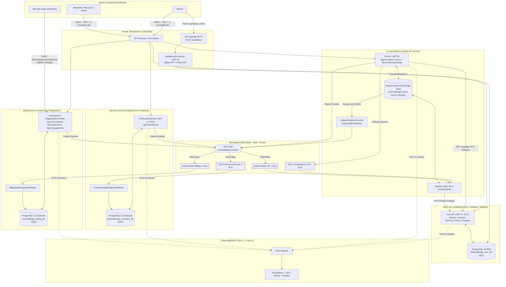
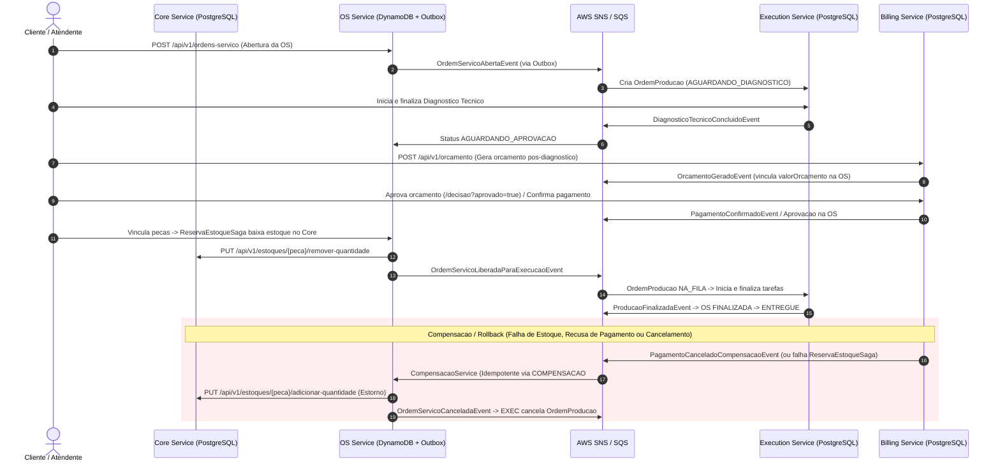

# Entrega Oficial — Tech Challenge Fase 4 (SOAT / FIAP)

> **Projeto:** Sistema Distribuído de Gestão de Oficina Mecânica em Escala Nacional  
> **Pós-Tech FIAP — Software Architecture (SOAT)** | **Organização GitHub:** `https://github.com/SOAT-FIAP-2026`

---

## 1. Nome e Identificação dos Participantes

| Nome | RM |
|---|---|
| Gabriel Gregório Silveira Netto | rm370723 |
| Diógenes | rm370708 |
| Luiz | *(preencher RM)* |
| Cristovão | rm370639 |

---

## 2. Links dos Repositórios

O ecossistema é composto por **8 repositórios independentes** na organização `SOAT-FIAP-2026`, segregando microsserviços, autenticação serverless, contratos/BDD e infraestrutura como código (Terraform):

| # | Repositório | Link Oficial | Responsabilidade Principal | Stack & Banco de Dados |
|---|---|---|---|---|
| 1 | **`os-microservice`** | https://github.com/SOAT-FIAP-2026/os-microservice | Ciclo de vida da OS, `ReservaEstoqueSaga`, Transactional Outbox e compensações | .NET 8 + **Amazon DynamoDB** (NoSQL Single-Table) |
| 2 | **`execution-service`** | https://github.com/SOAT-FIAP-2026/execution-service | Diagnóstico técnico, fila FIFO de produção, tarefas e métricas de oficina | .NET 8 + **PostgreSQL 16** (`techchallenge_execution_db`) |
| 3 | **`billing-service`** | https://github.com/SOAT-FIAP-2026/billing-service | Geração e aprovação de orçamento, cobrança e webhook Mercado Pago | .NET 8 + **PostgreSQL 16** (`techchallenge_billing_db`) |
| 4 | **`fase1-tech-challenge`** | https://github.com/SOAT-FIAP-2026/fase1-tech-challenge | Core: clientes, veículos, catálogo de serviços/peças, estoque e auth Staff | .NET 8 + **PostgreSQL 16 RDS** (`techchallenge_core_db`) |
| 5 | **`lambda-auth-function`** | https://github.com/SOAT-FIAP-2026/lambda-auth-function | Edge Facade Serverless: autenticação de clientes por CPF (`POST /auth/token`) | .NET 8 (AWS Lambda + Dapper) sobre domínio Core |
| 6 | **`shared`** | https://github.com/SOAT-FIAP-2026/shared | Pacote `Fiap.TechChallenge.Contracts`, testes de contrato, BDD E2E e Docker Compose | .NET 8 + xUnit + Reqnroll 2.2 + Floci (AWS Local) |
| 7 | **`soat-infra`** | https://github.com/SOAT-FIAP-2026/soat-infra | Infraestrutura Cloud (VPC, IAM, EKS, ALB, API Gateway e stack de observabilidade) | Terraform + Helm (Prometheus, Grafana, Loki, Tempo) |
| 8 | **`soat-db`** | https://github.com/SOAT-FIAP-2026/soat-db | Provisionamento gerenciado de banco de dados relacional e alarmes | Terraform + AWS RDS PostgreSQL 16 |

---

## 3. Link do Vídeo de Demonstração (até 15 minutos)

* **Plataforma:** YouTube / Vimeo *(público ou não listado)*
* **URL do Vídeo:** `[INSERIR LINK DO VÍDEO AQUI]`

---

## 4. Diagrama Geral da Arquitetura Final

A arquitetura adota **Microsserviços orientados a Domínio**, **Persistência Poliglota isolada por serviço (DynamoDB NoSQL + PostgreSQL SQL)**, **Mensageria Assíncrona (AWS SNS + SQS + DLQs)** e **Observabilidade Unificada (OpenTelemetry, Prometheus, Loki, Tempo e Grafana)**.

### Matriz de Persistência e Comunicação entre Microsserviços

> **Isolamento de Dados:** Nenhum microsserviço acessa diretamente o banco de dados de outro microsserviço. A `lambda-auth-function` atua exclusivamente como *Edge Facade* de leitura do próprio domínio Core (`Clientes`).

| Microsserviço | Banco de Dados Próprio | Comunicação Síncrona (REST) | Comunicação Assíncrona (SNS / SQS) |
|---|---|---|---|
| **Core (`fase1-tech-challenge`)** | PostgreSQL 16 (`techchallenge_core_db`) | Expõe clientes, veículos, catálogo, reserva/estorno de estoque e login Staff. | Atende consultas de catálogo e movimentações de estoque do `os-microservice`. |
| **OS (`os-microservice`)** | DynamoDB (`techchallenge-ordem-servico`) | Expõe `/api/v1/ordens-servico/*`; consulta catálogo e baixa estoque no Core. | Publica eventos via **Transactional Outbox** (`DynamoDB Streams -> SNS`); consome filas de eventos e compensação. |
| **Execução (`execution-service`)** | PostgreSQL 16 (`techchallenge_execution_db`) | Expõe `/api/v1/producao/*` (diagnóstico, fila FIFO e execução de tarefas). | Consome abertura/liberação/cancelamento da OS; publica `DiagnosticoIniciadoEvent`, `DiagnosticoTecnicoConcluidoEvent`, `ProducaoIniciadaEvent`, `ProducaoFinalizadaEvent` e `ProducaoCanceladaEvent`. |
| **Billing (`billing-service`)** | PostgreSQL 16 (`techchallenge_billing_db`) | Expõe `/api/v1/orcamento` (gerar orçamento), `/api/v1/orcamento/{id}/decisao` (aprovar orçamento) e `/api/v1/pagamento/*`. | Consome `DiagnosticoTecnicoConcluidoEvent` e `ProducaoCanceladaEvent`; publica `OrcamentoGeradoEvent`, `PagamentoConfirmadoEvent`, `PagamentoCanceladoCompensacaoEvent` e `PagamentoEstornadoEvent`. |

---

## 5. Estratégia Escolhida para o Saga Pattern

Adotou-se uma **Saga Híbrida (Orquestração Local + Transactional Outbox + Coreografia por Eventos)**, combinando consistência imediata na reserva de estoque com alto desacoplamento entre os domínios de OS, Diagnóstico/Execução e Faturamento:

1. **Orquestração Local na Baixa de Estoque (`ReservaEstoqueSaga` no `os-microservice`):**
   - Na reserva de peças para a OS, `ReservaEstoqueSaga` grava o estado `SAGA#{idSaga}` no DynamoDB e executa a baixa no Core Service (`PUT /api/v1/estoques/{id}/remover-quantidade`) peça a peça.
   - Em caso de falha parcial (ex.: falta de estoque na 2ª peça ou conflito de concorrência), a saga aciona compensação imediata publicando `ComandoCompensacao` na fila SQS `techchallenge-ordem-servico-compensacao` (com DLQ após 5 tentativas) para estornar apenas as peças já reservadas (`PUT /adicionar-quantidade`).
2. **Transactional Outbox no DynamoDB (`TransactWriteItems` + DynamoDB Streams):**
   - O agregado `OS#{id}` e os eventos `OUTBOX#{idEvento}` são persistidos na mesma transação atômica no DynamoDB. A `OutboxPublisherFunction` lê o stream e publica no AWS SNS com `X-Correlation-ID`, eliminando falhas de *dual-write*.
3. **Coreografia Distribuída e Rollback por Eventos (AWS SNS + SQS):**
   - **Fluxo Positivo (Happy Path):** Abertura da OS (`OrdemServicoAbertaEvent`) → Diagnóstico no Execution Service (`DiagnosticoTecnicoConcluidoEvent`) → Geração de orçamento no Billing Service (`OrcamentoGeradoEvent`) → Aprovação do orçamento pelo cliente e confirmação de pagamento (`PagamentoConfirmadoEvent`) → Baixa de estoque no Core Service e liberação da OS (`OrdemServicoLiberadaParaExecucaoEvent`) → Execução do reparo (`ProducaoFinalizadaEvent`) → Entrega do veículo.
   - **Compensações Distribuídas Idempotentes (`CompensacaoService` + `COMPENSACAO#{id}` no DynamoDB):**
     - *Pagamento recusado/cancelado no Mercado Pago:* `billing-service` publica `PagamentoCanceladoCompensacaoEvent` → `os-microservice` cancela a OS, estorna peças no Core e publica `OrdemServicoCanceladaEvent` → `execution-service` cancela a `OrdemProducao`.
     - *Orçamento reprovado pelo cliente ou produção cancelada na oficina (`ProducaoCanceladaEvent`):* estorno idempotente do estoque no Core, cancelamento da OS no DynamoDB e cancelamento/estorno do pagamento no Billing Service.

---

## 6. Justificativa da Divisão dos Microsserviços e Tecnologias Utilizadas

### 6.1 Divisão por Bounded Contexts (DDD)

1. **`fase1-tech-challenge` (Core) + `lambda-auth-function`:** Isola dados cadastrais (Clientes, Veículos, Catálogo) e o controle transacional de Estoque. A autenticação de clientes por CPF em AWS Lambda absorve picos de acesso na borda sem impactar o cluster EKS.
2. **`os-microservice` (Ordem de Serviço):** Centraliza a máquina de estados da OS, a orquestração da reserva de insumos e as compensações, escalando leituras e transições de status de forma independente.
3. **`execution-service` (Diagnóstico e Produção):** Desacopla a operação de oficina (diagnóstico mecânico, fila FIFO e apontamento de tarefas) das rotinas financeiras e de atendimento.
4. **`billing-service` (Orçamento e Pagamento):** Isola cálculos de orçamento, aprovação do cliente e integração criptográfica (HMAC-SHA256) com o Mercado Pago, garantindo auditoria e segurança financeira.
5. **`shared`:** Padroniza contratos de eventos/DTOs (`Fiap.TechChallenge.Contracts`), propagação de `X-Correlation-ID`, testes de contrato (137 testes) e testes BDD E2E com Reqnroll.

### 6.2 Tecnologias Utilizadas e Persistência Poliglota

| Camada | Tecnologia | Justificativa |
|---|---|---|
| **Linguagem & Runtime** | **.NET 8 (C# 12) / ASP.NET Core / AWS Lambda** | Alta performance, suporte nativo a containers K8s, workers SQS (`BackgroundService`) e funções serverless AWS Lambda. |
| **Banco NoSQL (`os-microservice`)** | **Amazon DynamoDB (Single-Table)** | Baixa latência em leituras/escritas por chave (`OS#`, `SAGA#`, `OUTBOX#`, `COMPENSACAO#`), controle de concorrência otimista (`TransactWriteItems`), TTL nativo e **DynamoDB Streams** para Transactional Outbox sem polling. |
| **Bancos SQL (`Core`, `Execution`, `Billing`)** | **PostgreSQL 16 (3 instâncias isoladas)** | Garantia ACID e integridade relacional para saldos de estoque (`core_db`), fila FIFO/tarefas (`execution_db`) e registros financeiros de orçamentos/pagamentos (`billing_db`). |
| **Mensageria Assíncrona** | **AWS SNS + AWS SQS + DLQs** | Fanout de eventos de domínio via SNS (`FilterPolicy` por `tipoEvento`) para filas SQS dedicadas por microsserviço, garantindo entrega *at-least-once*, retentativas e isolamento de falhas em Dead Letter Queues. |
| **Infraestrutura & CI/CD** | **AWS EKS (Kubernetes), Terraform & GitHub Actions** | Infraestrutura imutável provisionada via Terraform (`soat-infra`, `soat-db`), manifestos K8s com HPA/probes e pipelines independentes de build, testes, SonarCloud e deploy. |
| **Observabilidade & Qualidade** | **OpenTelemetry, Prometheus, Grafana, Loki, Tempo, SonarCloud & Reqnroll (BDD)** | Rastreamento distribuído ponta a ponta (`X-Correlation-ID`), métricas e logs centralizados herdados da Fase 3, cobertura de testes unitários/integrados e fluxos E2E validados em BDD (Gherkin `pt-BR`). |
