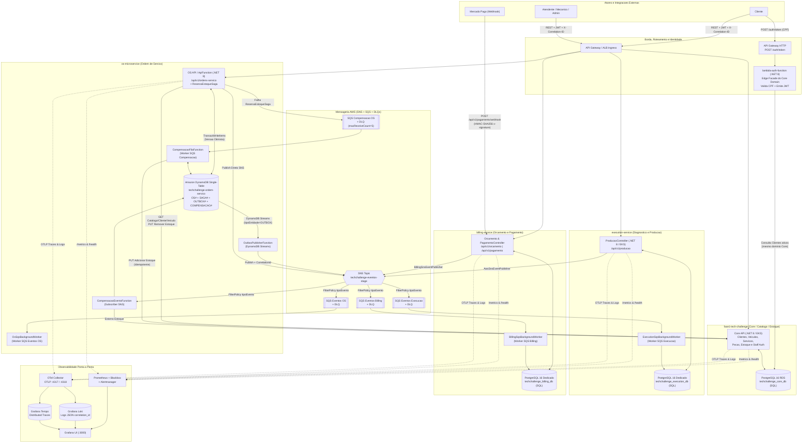
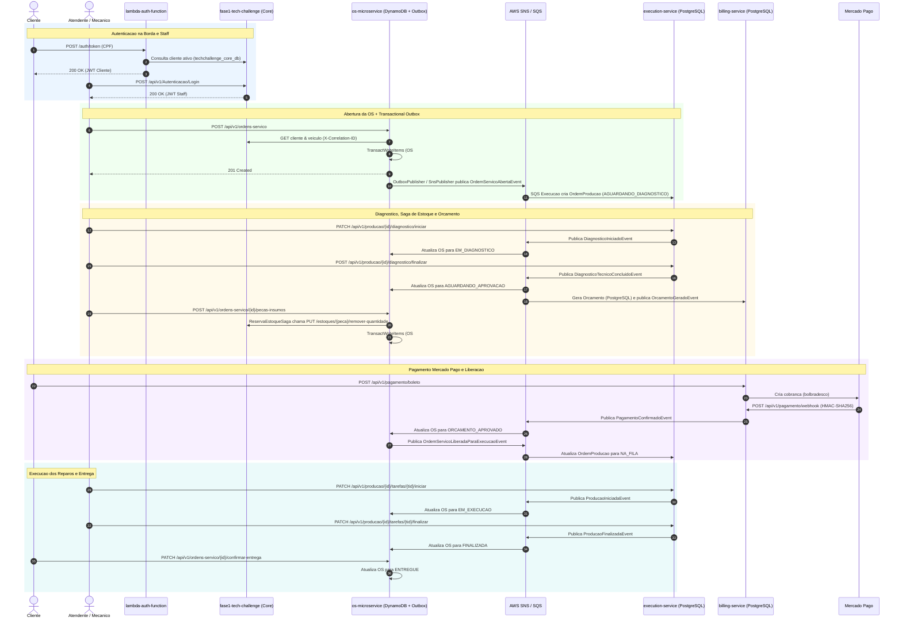
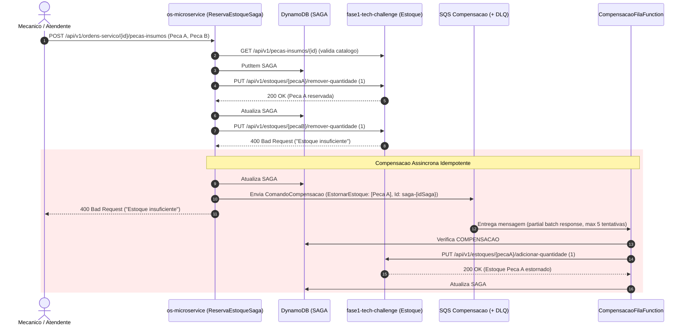
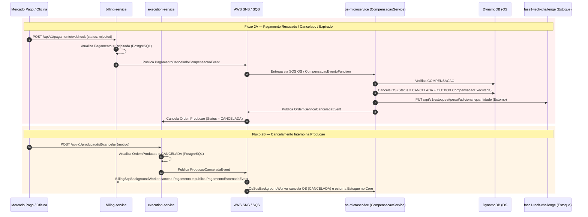

# Entrega Oficial — Tech Challenge Fase 4 (SOAT / FIAP)

> **Documento Consolidado para Entrega no Portal (Exportação PDF)**  
> **Projeto:** Sistema Distribuído de Gestão de Oficina Mecânica em Escala Nacional  
> **Pós-Tech FIAP — Software Architecture (SOAT)**  
> **Organização GitHub:** `SOAT-FIAP-2026`  
> **Data de Consolidação:** Novembro de 2026

> **Checklist pré-exportação (PDF):** Preencha os campos destacados com `[PREENCHER: ...]` nas **Seções 1 e 3** (dados dos participantes e link do vídeo de demonstração) antes de gerar o PDF final para upload no portal.

---

## 1. Identificação do Grupo e Participantes

| Campo | Informação |
|---|---|
| **Grupo / Turma** | `[PREENCHER: Nome do Grupo / Turma SOAT]` |
| **Disciplina / Fase** | Tech Challenge — Fase 4 (Arquitetura de Microsserviços, Saga Pattern, BDD & CI/CD) |
| **Organização GitHub** | `https://github.com/SOAT-FIAP-2026` |

### Integrantes do Grupo

| Nome Completo | E-mail Institucional | RM | Papel / Contribuição Principal |
|---|---|---|---|
| `[PREENCHER: Nome Completo]` | `[PREENCHER: e-mail@fiap.com.br]` | `[PREENCHER: RMXXXXX]` | `[PREENCHER: Ex.: Arquitetura / OS Microservice / Saga]` |
| `[PREENCHER: Nome Completo]` | `[PREENCHER: e-mail@fiap.com.br]` | `[PREENCHER: RMXXXXX]` | `[PREENCHER: Ex.: Execution Service / Observabilidade]` |
| `[PREENCHER: Nome Completo]` | `[PREENCHER: e-mail@fiap.com.br]` | `[PREENCHER: RMXXXXX]` | `[PREENCHER: Ex.: Billing Service / Mercado Pago]` |
| `[PREENCHER: Nome Completo]` | `[PREENCHER: e-mail@fiap.com.br]` | `[PREENCHER: RMXXXXX]` | `[PREENCHER: Ex.: Core Service / Infra Terraform & EKS]` |
| `[PREENCHER: Nome Completo]` | `[PREENCHER: e-mail@fiap.com.br]` | `[PREENCHER: RMXXXXX]` | `[PREENCHER: Ex.: Lambda Auth / Contratos / BDD E2E]` |

---

## 2. Links dos Repositórios Oficiais

O ecossistema é composto por **8 repositórios independentes** na organização `SOAT-FIAP-2026`, segregando os 4 microsserviços de negócio, a Edge Facade serverless de autenticação, o pacote compartilhado de contratos/BDD e os repositórios dedicados de Infraestrutura como Código (Terraform):

| # | Repositório | URL Oficial (GitHub) | Papel na Arquitetura | Runtime & Persistência | CI/CD & Infraestrutura |
|---|---|---|---|---|---|
| 1 | **`os-microservice`** | `https://github.com/SOAT-FIAP-2026/os-microservice` | **Ordem de Serviço** (abertura, ciclo de vida, orquestração da Saga de estoque, Transactional Outbox e compensações) | .NET 8 (AWS Lambda / Kestrel) + **Amazon DynamoDB** (NoSQL Single-Table) | GitHub Actions (`ci.yml`, `cd.yml` GHCR, `sonar.yml`) + SAM (`infra/template.yaml`) + K8s (`k8s/base/`) |
| 2 | **`execution-service`** | `https://github.com/SOAT-FIAP-2026/execution-service` | **Execução e Produção** (diagnóstico técnico, fila FIFO de produção, apontamento de tarefas e métricas de oficina) | .NET 8 (ASP.NET Core) + **PostgreSQL 16** dedicado (`techchallenge_execution_db`) | GitHub Actions (`ci.yml`, `cd.yml` GHCR, `sonar.yml`) + K8s (`k8s/base/`) |
| 3 | **`billing-service`** | `https://github.com/SOAT-FIAP-2026/billing-service` | **Orçamento e Pagamento** (cálculo/envio de orçamento, cobrança Pix/Boleto e webhook HMAC-SHA256 Mercado Pago) | .NET 8 (ASP.NET Core / Lambda) + **PostgreSQL 16** dedicado (`techchallenge_billing_db`) | GitHub Actions (`sonar.yml`, `deploy-aws-s3.yml` Lambda) + K8s (`k8s/base/`, `overlays/`, `observability/`) |
| 4 | **`fase1-tech-challenge`** | `https://github.com/SOAT-FIAP-2026/fase1-tech-challenge` | **Core / Catálogo / Estoque** (clientes, veículos, catálogo de serviços/peças, saldo de estoque e autenticação Staff) | .NET 8 (Clean Arch / DDD) + **PostgreSQL 16** RDS dedicado (`techchallenge_core_db`) | GitHub Actions (`ci.yml`, `cd.yaml` Docker Hub + EKS rollout, `sonar.yaml`) + K8s (`k8s/base/`, `overlays/`) |
| 5 | **`lambda-auth-function`** | `https://github.com/SOAT-FIAP-2026/lambda-auth-function` | **Edge Facade Serverless de Identidade** (autenticação de clientes por CPF `POST /auth/token` e emissão de JWT) | .NET 8 (AWS Lambda + Dapper/Npgsql) sobre domínio Core | GitHub Actions (`build.yml` + SonarCloud, `cd.yml` Lambda + Terraform) + Terraform (`infra/`) |
| 6 | **`shared`** | `https://github.com/SOAT-FIAP-2026/shared` | **Contratos, Correlação, Ambiente Local & BDD E2E** (`Fiap.TechChallenge.Contracts`, `Contracts.Tests`, 4 features Reqnroll, Docker Compose + Floci) | .NET 8 Classlib + xUnit + Reqnroll 2.2 + Floci + Stack Observabilidade | GitHub Actions (`ci-publish.yml`, `e2e.yml` manual) + Docker Compose unificado |
| 7 | **`soat-infra`** | `https://github.com/SOAT-FIAP-2026/soat-infra` | **Infraestrutura Cloud Central (IaC)** (VPC, Subnets, IAM, AWS EKS, ALB, API Gateway, Lambda Auth e Observabilidade Helm) | Terraform + Helm (Prometheus, Grafana, Loki, Tempo, OTel Collector) | GitHub Actions (`pr.yml`) + Remote State S3 + SSM Parameter Store |
| 8 | **`soat-db`** | `https://github.com/SOAT-FIAP-2026/soat-db` | **Infraestrutura de Banco Gerenciado (IaC)** (AWS RDS PostgreSQL 16, Subnet Group, Security Group e CloudWatch Alarms) | Terraform + AWS RDS PostgreSQL 16 + SSM Parameter Store | GitHub Actions (`pr.yml`) + Remote State S3 |

**Remotes Git verificados:**
- `https://github.com/SOAT-FIAP-2026/os-microservice.git`
- `https://github.com/SOAT-FIAP-2026/execution-service.git`
- `https://github.com/SOAT-FIAP-2026/billing-service.git`
- `https://github.com/SOAT-FIAP-2026/fase1-tech-challenge.git`
- `https://github.com/SOAT-FIAP-2026/lambda-auth-function.git`
- `https://github.com/SOAT-FIAP-2026/shared.git`
- `https://github.com/SOAT-FIAP-2026/soat-infra.git`
- `https://github.com/SOAT-FIAP-2026/soat-db.git`

---

## 3. Vídeo de Demonstração (até 15 minutos)

| Item | Valor |
|---|---|
| **Link do Vídeo** | `[PREENCHER: Link YouTube/Vimeo (Público ou Não Listado) — Duração máxima 15 min]` |
| **Plataforma / Visibilidade** | YouTube ou Vimeo (Público ou Não Listado) |
| **Duração Máxima Exigida** | Até 15 minutos |

### Roteiro Estruturado da Demonstração (Alinhado ao `FASE_4.md`)

| Bloco | Janela de Tempo | Requisito Demonstrado (`FASE_4.md`) | Evidências Apresentadas no Vídeo |
|---|---|---|---|
| **1. Visão Geral & Repositórios** | `00:00 – 02:00` | Arquitetura distribuída e separação de repositórios | Exibição dos repositórios independentes, bancos isolados (DynamoDB Single-Table no `os-microservice` e 3 bancos PostgreSQL dedicados em Core, Execution e Billing) e topologia SNS/SQS (Floci UI / AWS Console). |
| **2. Fluxo Completo da OS (Happy Path)** | `02:00 – 06:30` | Fluxo completo de uma OS passando pelos microsserviços | 1. Login Cliente (`POST /auth/token`) e Staff (`POST /api/v1/autenticacao/Login`). 2. Abertura da OS no `os-microservice` (`POST /api/v1/ordens-servico`), gravação atômica OS + Outbox no DynamoDB e consumo no `execution-service`. 3. Diagnóstico no `execution-service` (`PATCH .../diagnostico/iniciar` e `POST .../diagnostico/finalizar`), inclusão de peças/serviços com baixa de estoque no Core. 4. Geração de orçamento e cobrança no `billing-service` (`POST /api/v1/pagamento/boleto`) + simulação de webhook aprovado (`POST /api/v1/pagamento/webhook`). 5. Liberação automática para `NA_FILA`, execução de tarefas no `execution-service` e confirmação de entrega no `os-microservice`. |
| **3. Saga Pattern & Rollbacks** | `06:30 – 09:30` | Execução do Saga Pattern e tratamento de falhas | 1. **Cenário A (Falha Síncrona de Estoque):** Inclusão de peça sem saldo suficiente na `ReservaEstoqueSaga`, retorno HTTP 400 imediato e estorno assíncrono das peças já baixadas via SQS `CompensacaoFilaFunction`. 2. **Cenário B (Compensação Assíncrona por Pagamento/Produção):** Recusa de pagamento no webhook do `billing-service` emitindo `PagamentoCanceladoCompensacaoEvent` no SNS, consumo idempotente no `os-microservice`, cancelamento da OS no DynamoDB, estorno de estoque no Core e cancelamento da `OrdemProducao` no Execution. |
| **4. CI/CD Automatizado & K8s** | `09:30 – 12:30` | Deploy automatizado de pelo menos um microsserviço com validação de testes | Execução/inspeção de pipeline GitHub Actions (`ci.yml`, `cd.yaml`/`cd.yml`, `sonar.yml`), validação dos testes unitários e de contratos/BDD, Quality Gate no SonarCloud e rollout automatizado em Kubernetes / EKS (`kubectl get pods -n techchallenge`, `kubectl rollout status`). |
| **5. Observabilidade & Rastreamento** | `12:30 – 15:00` | Monitoramento e rastreamento dos fluxos distribuídos | Rastreamento ponta a ponta usando `X-Correlation-ID` propagado entre HTTP, DynamoDB Outbox, SNS e SQS: consulta de logs JSON estruturados no **Grafana Loki** (`correlation_id`, `os_id`), distributed traces no **Grafana Tempo** (via OpenTelemetry Collector) e dashboards de métricas **Prometheus** (`/metrics` + Blackbox Exporter). |

---

## 4. Diagrama Geral da Arquitetura Final

A arquitetura final adota **Microsserviços orientados a Domínio**, **Persistência Poliglota (NoSQL + SQL isolado por serviço)**, **Mensageria Assíncrona Pub/Sub (AWS SNS + SQS + DLQs)** e **Telemetria Unificada (OpenTelemetry, Prometheus, Loki e Tempo)**.

### Decisão Arquitetural Formal: Fronteira da `lambda-auth-function`

* **Papel:** A [`lambda-auth-function`](https://github.com/SOAT-FIAP-2026/lambda-auth-function) atua exclusivamente como **Edge Facade Serverless do domínio Core (`fase1-tech-challenge`)**, autenticando clientes por CPF (`POST /auth/token`) na borda via API Gateway HTTP e emitindo tokens JWT HMAC-SHA256.
* **Isolamento de Banco Respeitado:** Embora acesse a tabela de `Clientes` em `techchallenge_core_db` (via Dapper/Npgsql com leitura apenas de verificação de existência e `ApagadoEm IS NULL`), essa função **pertence formalmente ao Bounded Context de Identidade/Cadastro do Core Service**. Nenhum outro microsserviço (`os-microservice`, `execution-service` ou `billing-service`) acessa diretamente o banco de outro microsserviço — toda comunicação entre domínios distintos ocorre exclusivamente via **APIs REST autenticadas** ou **eventos assíncronos AWS SNS/SQS**.

### Matriz de Comunicação e Persistência por Serviço

| Microsserviço | Banco Próprio | Tecnologia | Comunicação Síncrona (REST) | Comunicação Assíncrona (Mensageria) |
|---|---|---|---|---|
| **`fase1-tech-challenge` (Core)** | `techchallenge_core_db` | PostgreSQL 16 (RDS) | Expõe CRUD de Clientes, Veículos, Serviços, Peças, Estoque (`/api/v1/estoques/*`) e Auth Staff (`/api/v1/Autenticacao/Login`). | — *(Consome demandas síncronas de catálogo e baixa/estorno de estoque do `os-microservice`).* |
| **`os-microservice` (OS)** | `techchallenge-ordem-servico-<stage>` | Amazon DynamoDB (NoSQL Single-Table) | Expõe `/api/v1/ordens-servico/*`; consulta Core (`CoreApiClient`) e executa baixa de estoque na inclusão de peças. | **Outbox (`DynamoDB Streams -> OutboxPublisherFunction`)** + publicação SNS; consome eventos via `OsSqsBackgroundWorker` / `CompensacaoEventoFunction` e compensações via `CompensacaoFilaFunction` (SQS). |
| **`execution-service` (Execução)** | `techchallenge_execution_db` | PostgreSQL 16 | Expõe `/api/v1/producao/*` (diagnóstico, fila FIFO, início/fim de tarefas, cancelamento e produtividade). | Publica `DiagnosticoIniciadoEvent`, `DiagnosticoTecnicoConcluidoEvent`, `ProducaoIniciadaEvent`, `ProducaoFinalizadaEvent`, `ProducaoCanceladaEvent` no SNS; consome fila SQS `techchallenge-execucao-eventos`. |
| **`billing-service` (Billing)** | `techchallenge_billing_db` | PostgreSQL 16 | Expõe `/api/v1/orcamento/*`, `/api/v1/pagamento/boleto`, `/api/v1/pagamento/{id}` e `/api/v1/pagamento/webhook` (Mercado Pago). | Publica `OrcamentoGeradoEvent`, `PagamentoConfirmadoEvent`, `PagamentoCanceladoCompensacaoEvent`, `PagamentoEstornadoEvent` no SNS; consome fila SQS `techchallenge-billing-eventos`. |

---

## 5. Estratégia e Justificativa do Saga Pattern

### 5.1 Estratégia Adotada: **Saga Híbrida (Orquestração Local + Transactional Outbox + Coreografia Distribuída)**

O ciclo completo de uma Ordem de Serviço combina transações de curta duração que exigem feedback síncrono imediato ao usuário com processos de negócio de longa duração que atravessam múltiplos departamentos da oficina (diagnóstico mecânico, aprovação/pagamento pelo cliente via Mercado Pago e reparo em fila de produção). Por isso, adotou-se uma **Saga Híbrida** composta por três pilares complementares implementados em código:

1. **Orquestração Local na Reserva de Estoque (`ReservaEstoqueSaga` em `os-microservice`):**
   - Ao incluir peças/insumos em uma OS (`POST /api/v1/ordens-servico/{id}/pecas-insumos`), o método `OrdemServicoService.IncluirPecaInsumo` delega o fluxo para `ReservaEstoqueSaga.Executar(...)`.
   - O orquestrador persiste o estado da saga no DynamoDB (`SAGA#{idSaga}` com status `Iniciada`), executa a baixa de estoque peça a peça no Core Service (`PUT /api/v1/estoques/{idPecaInsumo}/remover-quantidade`) registrando cada peça reservada em `SAGA#{idSaga}`, e só então executa o `passoFinal` (atualização atômica da OS + registro do evento `PecasInsumoIncluidas` no Outbox).
   - Se qualquer passo falhar (ex.: estoque insuficiente para a 2ª peça ou erro de concorrência otimista no DynamoDB), `ReservaEstoqueSaga.Compensar(...)` marca a saga como `Compensando` e publica um `ComandoCompensacao` (`TipoCompensacao.EstornarEstoque`) contendo **apenas as peças efetivamente baixadas** na fila SQS `techchallenge-ordem-servico-compensacao`, relançando o erro original para que a API devolva HTTP 400 imediatamente.
   - A Lambda `CompensacaoFilaFunction` consome a fila SQS com *partial batch failure* (`SQSBatchResponse`), 5 tentativas antes de enviar à DLQ (`techchallenge-ordem-servico-compensacao-dlq`), invocando `CompensacaoService.Executar` para estornar cada peça no Core (`PUT /api/v1/estoques/{idPecaInsumo}/adicionar-quantidade`).

2. **Transactional Outbox Atômico no DynamoDB (`OrdemServicoRepository` + `OutboxPublisherFunction`):**
   - Para eliminar o problema clássico de *dual-write* (gravar no banco e falhar ao publicar no broker), toda gravação de estado em `OrdemServicoRepository.Gravar` usa **`TransactWriteItems`** gravando na mesma transação atômica o agregado `OS#{id}` (com verificação de concorrência otimista `versao = :versaoLida`) e os itens `OUTBOX#{idEvento}` (com `TTL` em `expiraEm` e `correlationId`).
   - O **DynamoDB Streams** (`NEW_IMAGE`, filtrado por `eventName = INSERT` e `tipoEntidade = OUTBOX`) aciona a `OutboxPublisherFunction`, que publica no tópico SNS `techchallenge-eventos-<stage>` preservando a ordem do shard via `StreamsEventResponse.BatchItemFailures` e encaminhando falhas persistentes após 10 tentativas para a `OutboxDLQ`.

3. **Coreografia Distribuída e Compensação Baseada em Eventos (AWS SNS + SQS + `CompensacaoService`):**
   - Entre os domínios **OS (`os-microservice`)**, **Execução (`execution-service`)** e **Faturamento (`billing-service`)**, o fluxo é **coreografado por eventos** no tópico SNS unificado `techchallenge-eventos-<stage>` com roteamento por `FilterPolicy` no atributo `tipoEvento` para filas SQS dedicadas por serviço (cada uma com sua respectiva DLQ).
   - **Idempotência de Compensação:** Tanto a compensação por fila (`CompensacaoFilaFunction`) quanto a compensação por evento (`CompensacaoEventoFunction` / `OsSqsBackgroundWorker`) convergem em `CompensacaoService.Executar`, que grava `COMPENSACAO#{idCompensacao}` no DynamoDB e marca individualmente cada `PecaEstornada` antes de concluir — impedindo estorno duplicado em caso de entrega *at-least-once* do SQS/SNS.
   - **Gatilhos de Compensação Distribuída:**
     - **Recusa / Cancelamento / Expiração de Pagamento:** `PagamentoService` publica `PagamentoCanceladoCompensacaoEvent` -> `os-microservice` cancela a OS (`CANCELADA`), estorna peças no Core e publica `OrdemServicoCanceladaEvent` -> `execution-service` cancela `OrdemProducao` (`CANCELADA`).
     - **Reprovação de Orçamento pelo Cliente:** `OrdemServicoService.AprovarOrcamento(id, false)` registra `OrcamentoReprovado` via Outbox -> compensação estorna peças reservadas no Core.
     - **Cancelamento Interno na Oficina (`POST /api/v1/producao/{id}/cancelar`):** `execution-service` publica `ProducaoCanceladaEvent` -> `billing-service` cancela pagamento e publica `PagamentoEstornadoEvent`; `os-microservice` cancela OS no DynamoDB e estorna peças no Core.

### 5.2 Justificativa da Escolha (Por que Híbrida?)

| Critério | Orquestração Pura (Central) | Coreografia Pura | **Saga Híbrida (Adotada)** |
|---|---|---|---|
| **Consistência imediata na reserva de peças** | Alta, porém centralizaria todo o ecossistema em um orquestrador monolítico. | Difícil: exigiria polling/SSE para o atendente saber se houve estoque insuficiente. | **Melhor dos dois mundos:** `ReservaEstoqueSaga` valida estoque sincronamente na OS e faz rollback garantido via SQS/DLQ em falhas parciais. |
| **Desacoplamento entre Contextos (OS, Execução, Billing)** | Baixo: um orquestrador central precisaria conhecer detalhes de diagnóstico, Mercado Pago e fila de mecânicos. | Alto: cada serviço reage apenas aos eventos de domínio que lhe dizem respeito. | **Alto desacoplamento:** OS, Execution e Billing evoluem e escalam de forma independente via SNS/SQS. |
| **Tolerância a falhas e processos longos** | Orquestrador vira *Single Point of Failure* e guarda estado de fluxos de dias (aguardando pagamento/reparo). | Resiliente com filas duráveis e DLQs, porém requer cuidado para rastrear fluxos. | **Alta resiliência:** Processos longos ficam em eventos SNS/SQS duráveis com DLQ + correlação explícita (`X-Correlation-ID`) e idempotência (`COMPENSACAO#`). |

---

### 5.3 Diagramas de Sequência da Saga (Happy Path e Cenários de Falha/Rollback)

#### Diagrama A — Fluxo Principal (Happy Path Completo)

#### Diagrama B — Cenário de Falha 1: Rollback na Reserva de Estoque (Saga Orquestrada + SQS)

#### Diagrama C — Cenário de Falha 2: Compensação Distribuída (Recusa de Pagamento e Cancelamento de Produção)

---

## 6. Justificativa da Divisão dos Microsserviços e Tecnologias Utilizadas

### 6.1 Divisão dos Microsserviços por Bounded Contexts (DDD)

A decomposição do monólito inicial seguiu os limites semânticos de negócio (*Bounded Contexts* do Domain-Driven Design), evitando microsserviços granulares demais (nano-serviços) ou acoplamento por banco compartilhado:

1. **`fase1-tech-challenge` (Core / Catálogo / Estoque) + `lambda-auth-function` (Edge Facade):** Concentra os dados mestres de baixa volatilidade relativa (Clientes, Veículos, Catálogo de Serviços e Peças/Insumos), o controle transacional de saldo de Estoque e a autenticação Staff/Cliente. A extração da autenticação de clientes por CPF para a `lambda-auth-function` isola picos de login na borda (Serverless/API Gateway) sem sobrecarregar o cluster EKS.
2. **`os-microservice` (Ordem de Serviço):** Gerencia o agregado central de negócio (`OrdemServico`), a máquina de estados da OS, a consolidação de itens/orçamento e a coordenação transacional da reserva de peças (`ReservaEstoqueSaga`) e compensações. Por concentrar maior volume de consultas de status/progresso e transições de estado, opera de forma independente em **Amazon DynamoDB** e suporta execução tanto serverless (AWS Lambda + API Gateway) quanto em container K8s.
3. **`execution-service` (Diagnóstico e Produção):** Isola o domínio operacional do chão de oficina: diagnóstico técnico pelo mecânico, fila ordenada (FIFO) de execução de ordens liberadas, apontamento granular de início/fim de tarefas e cálculo de métricas de produtividade — permitindo que a equipe de oficina opere mesmo sob picos no portal de faturamento.
4. **`billing-service` (Orçamento e Pagamento):** Isola regras financeiras, cálculo/envio de orçamentos, geração de cobranças e validação criptográfica de webhooks externos (Mercado Pago `x-signature` HMAC-SHA256). Esse isolamento garante segurança reforçada, auditoria financeira dedicada e independência de deploy quando regras de meios de pagamento evoluem.
5. **`shared` (`Fiap.TechChallenge.Contracts` + BDD E2E):** Centraliza contratos de eventos/DTOs HTTP, helpers de correlação (`CorrelationContext`, `SnsCorrelationHelper`), testes de espelho de contrato (`Contracts.Tests`), infraestrutura local integrada (`docker-compose.yml` + Floci) e testes BDD ponta a ponta (`Fiap.TechChallenge.E2ETests`).

### 6.2 Justificativa da Persistência Poliglota (DynamoDB NoSQL vs PostgreSQL 16 SQL)

Cada microsserviço possui **armazenamento próprio e exclusivo**, sem compartilhamento de tabelas ou chaves estrangeiras entre serviços distintos:

* **Amazon DynamoDB (NoSQL Single-Table) no `os-microservice`:**
  - **Motivo da escolha:** A Ordem de Serviço é acessada predominantemente pelo seu identificador (`PK = OS#{id}`, `SK = METADATA`) e listada por índice secundário de status ativo (`GSI1`), carregando itens de serviço, peças e histórico em um único documento sem junções complexas.
  - **Ganhos arquiteturais:** Suporta escalabilidade elástica para picos de leitura/escrita em múltiplas filiais, concorrência otimista nativa (`ConditionExpression` em `TransactWriteItems`), **TTL automático** para expiração de registros transitórios (`expiraEm`), *Point-in-Time Recovery (PITR)* e **DynamoDB Streams** como motor nativo de **Transactional Outbox** (`OUTBOX#{idEvento}`) sem necessidade de jobs de polling no banco.
  - **Single-Table Design:** Coexistem particionados na mesma tabela `techchallenge-ordem-servico-<stage>` os registros `OS#`, `SAGA#`, `OUTBOX#` e `COMPENSACAO#`, permitindo transações atômicas entre entidade e evento.
* **PostgreSQL 16 (Relacional ACID) em 3 Bancos Dedicados (`techchallenge_core_db`, `techchallenge_execution_db`, `techchallenge_billing_db`):**
  - **Motivo da escolha:** Core, Execução e Faturamento possuem relacionamentos estruturados, restrições de integridade forte (ACID), queries analíticas/paginadas e controle concorrente clássico:
    - **`techchallenge_core_db`:** Integridade referencial entre Clientes, Veículos, Peças, Serviços e saldo numérico de Estoque.
    - **`techchallenge_execution_db`:** Integridade entre `OrdemProducao`, `Diagnostico`, `TarefaProducao` e ordenação determinística da fila FIFO + métricas de tempo por mecânico.
    - **`techchallenge_billing_db`:** Consistência financeira estrita para `Orcamento`, `Pagamento` e rastreamento de transações externas do Mercado Pago, com versionamento via EF Core Migrations.

### 6.3 Justificativa das Demais Tecnologias Utilizadas

| Categoria | Tecnologia Escolhida | Justificativa Técnica |
|---|---|---|
| **Plataforma & Linguagem** | **.NET 8 (C# 12) / ASP.NET Core** | Ecossistema unificado de alta performance, suporte nativo a Minimal APIs, Controllers, `BackgroundService` para workers SQS e runtime oficial AWS Lambda `dotnet8` (`Amazon.Lambda.*`). |
| **Mensageria & Resiliência** | **AWS SNS + AWS SQS + DLQs** | Arquitetura *serverless* totalmente gerenciada que desacopla publicadores de consumidores. O SNS faz *fanout* por `FilterPolicy` (`tipoEvento`), enquanto filas SQS dedicadas absorvem picos de carga, garantem entrega *at-least-once* com *visibility timeout*, *partial batch response* e isolam falhas permanentes em *Dead Letter Queues (DLQs)*. |
| **Orquestração & Cloud** | **Kubernetes (AWS EKS), Kustomize, AWS Lambda/SAM & Terraform** | Kubernetes no EKS (provisionado via `soat-infra` e `soat-db`) fornece *Horizontal Pod Autoscaler (HPA)*, *liveness/readiness probes* e containers *non-root*. Funções *event-driven* (`lambda-auth-function`, `OutboxPublisherFunction`, `CompensacaoFilaFunction`, `CompensacaoEventoFunction`) aproveitam escala sob demanda da AWS Lambda. |
| **Observabilidade (Fase 3 → Fase 4)** | **OpenTelemetry, Prometheus, Alertmanager, Grafana, Loki & Tempo** | Continuidade da stack da Fase 3 estendida para o ambiente distribuído: propagação de `X-Correlation-ID` (`CorrelationContext` + `SnsCorrelationHelper`) em chamadas HTTP, DynamoDB Outbox e envelopes SNS/SQS; exportação de traces OTLP para o **Tempo**, logs JSON correlacionados para o **Loki** e métricas `/metrics` + sondas **Blackbox Exporter** no **Prometheus/Grafana**. |
| **Qualidade, Contratos & BDD** | **xUnit, FluentAssertions, NetArchTest, Testcontainers, Coverlet, SonarCloud & Reqnroll 2.2** | Garantia contínua de qualidade com meta de cobertura ≥ 80%, validação de regras arquiteturais (`NetArchTest`), testes integrados reais com PostgreSQL em container (`Testcontainers`), análise estática no **SonarCloud**, validação de contratos em fio (`Contracts.Tests` — 137 testes aprovados) e suíte **BDD E2E em português (`pt-BR`) com Reqnroll 2.2** cobrindo 4 features (`1_CicloCompletoOrdemServico.feature`, `2_SagaCompensacaoFalhaEstoque.feature`, `3_SanidadeEContratosMicrosservicos.feature` e `4_FluxoFaturamentoEPagamentoOrdemServico.feature`). |
| **Ambiente Local Integrado** | **Docker Compose + Floci + Floci UI** | Emulação local fiel de AWS DynamoDB, Streams, SNS, SQS e SSM Parameter Store via **Floci** (`shared/docker-compose.yml` + `01-init-aws.sh`), integrada aos 3 bancos PostgreSQL dedicados e à stack completa de observabilidade para validação ponta a ponta antes do deploy em nuvem. |
