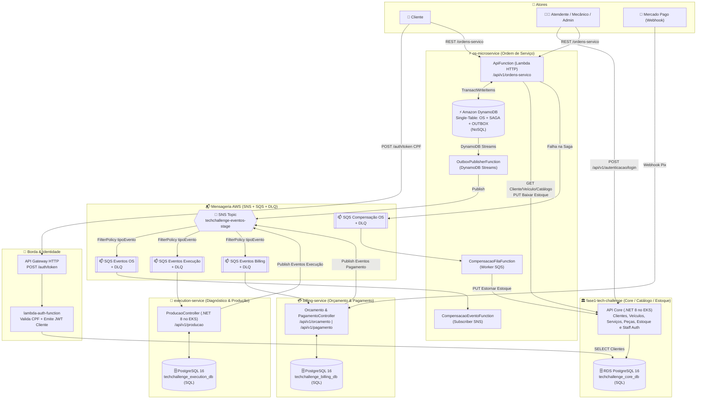

# 📦 Shared — Contratos de Integração (`Fiap.TechChallenge.Contracts`) & Execução Local

Repositório compartilhado entre os microsserviços do **Tech Challenge (Fase 4 — SOAT/FIAP)**:

1. **[`os-microservice`](../os-microservice)**: Microsserviço de **Ordem de Serviço** (AWS Lambda .NET 8 + **DynamoDB NoSQL** + Outbox + Saga de Reserva de Estoque e Compensação).
2. **[`fase1-tech-challenge`](../fase1-tech-challenge)**: Serviço **Core / Catálogo / Clientes / Veículos / Estoque / Staff Auth** (EKS + **PostgreSQL 16 RDS**).
3. **[`execution-service`](../execution-service)**: Microsserviço de **Diagnóstico Técnico e Execução/Produção** de chão de oficina (EKS + **PostgreSQL 16 dedicado**).
4. **[`billing-service`](../billing-service)**: Microsserviço de **Orçamento e Pagamento** integrado ao **Mercado Pago** (EKS + **PostgreSQL 16 dedicado**).
5. **[`lambda-auth-function`](../lambda-auth-function)**: Autenticação Serverless de clientes por **CPF** (AWS API Gateway + AWS Lambda .NET 8).

> 📄 **Documentação Completa e Validação da Fase 4:** veja [`ARQUITETURA_E_VALIDACAO_FASE4.md`](./ARQUITETURA_E_VALIDACAO_FASE4.md) com o diagrama de sequência ponta a ponta, checklist de gaps por repositório e matriz de validação contra os requisitos do edital.

---

## 🏗️ Arquitetura e Fluxo Completo da Aplicação (AWS SNS / SQS)



---

## 📁 Estrutura de Pastas dos Contratos

O pacote **espelha os contratos que os serviços trocam hoje** (versão `2.0.0`). A fonte da verdade é o código de quem publica o evento ou expõe a rota; o `shared` copia esse formato. Design: [`docs/superpowers/specs/2026-11-08-espelho-contratos-design.md`](docs/superpowers/specs/2026-11-08-espelho-contratos-design.md).

```text
shared/
├── src/Fiap.TechChallenge.Contracts/
│   ├── Common/          # IntegrationEvent, CorrelationContext, SnsMessageAttributes, paginação,
│   │                    # ErrorResponse / ProblemDetailsResponse, WireJsonOptions
│   ├── OsService/       # eventos IntegrationEvent, rotas, DTOs HTTP, status, comando de compensação
│   │   └── DomainEvents/  # eventos do outbox (EventoDominio) — sub-namespace próprio
│   ├── ExecutionService/  # eventos, rotas, requests, status de produção
│   │   └── Responses/     # respostas HTTP — sub-namespace próprio
│   ├── BillingService/  # eventos, rotas, boleto, orçamento, webhook Mercado Pago
│   ├── CoreService/     # rotas e DTOs do fase1 (catálogo, estoque)
│   └── AuthService/     # JWT (claims, roles, defaults), lambda-auth, login de staff
├── tests/
│   ├── Fiap.TechChallenge.Contracts.Tests/
│   │   ├── Wire/            # testes de espelho (forma no fio vs fixture)
│   │   ├── Support/         # WireShape, WireFixture
│   │   └── Fixtures/wire/   # formas capturadas dos tipos reais dos serviços
│   └── Fiap.TechChallenge.E2ETests/   # BDD (Reqnroll) — precisa da stack no ar
├── floci/init/ready.d/01-init-aws.sh
├── docker-compose.yml
└── Fiap.TechChallenge.Contracts.sln
```

Os sub-namespaces `OsService.DomainEvents` e `ExecutionService.Responses` existem porque os serviços têm tipos locais com os mesmos nomes; ficar fora dos namespaces que eles importam evita ambiguidade de compilação.

---

## 📜 Inventário de Contratos

### Formatos de JSON em uso (`WireJsonOptions`)

| Opção | Quem usa | Formato |
|---|---|---|
| `OsEventos` | eventos do `os-microservice` (outbox e publicação direta) | camelCase, nulos omitidos, enum como texto |
| `PadraoDotNet` | eventos do `billing-service` e do `execution-service`; resposta do `lambda-auth` | PascalCase, nulos escritos, enum como número |
| `Http` | APIs HTTP de todos os serviços | camelCase |

### Eventos (SNS `techchallenge-eventos-<stage>`)

| Evento (`tipoEvento`) | Tipo no `shared` | Produtor hoje | Consumidor(es) | Trafega? |
|---|---|---|---|---|
| `OrdemServicoCriada` | `OsService.DomainEvents.OrdemServicoCriada` | os (outbox) | execution (como alias de `OrdemServicoAbertaEvent`) | sim |
| `StatusOrdemServicoAlterado` | `OsService.DomainEvents.StatusOrdemServicoAlterado` | os (outbox) | — | sim |
| `PecasInsumoIncluidas` | `OsService.DomainEvents.PecasInsumoIncluidas` | os (outbox) | — | sim |
| `OrcamentoReprovado` | `OsService.DomainEvents.OrcamentoReprovado` | os (outbox) | os `CompensacaoEventoFunction` | sim |
| `OrdemServicoCancelada` | `OsService.DomainEvents.OrdemServicoCancelada` | os (outbox) | os `CompensacaoEventoFunction`, execution | sim |
| `CompensacaoExecutada` | `OsService.DomainEvents.CompensacaoExecutada` | os (outbox) | — | sim |
| `OrdemServicoAbertaEvent` | `Events.OrdemServicoAbertaEvent` | os (direto) | execution | sim |
| `OrdemServicoLiberadaParaExecucaoEvent` | `Events.OrdemServicoLiberadaParaExecucaoEvent` | os (direto, 2×) | execution | sim |
| `OrdemServicoCanceladaEvent` | `Events.OrdemServicoCanceladaEvent` | os (direto) | execution, billing, os | sim |
| `DiagnosticoIniciadoEvent` | `Events.DiagnosticoIniciadoEvent` | execution | os | sim |
| `DiagnosticoTecnicoConcluidoEvent` | `Events.DiagnosticoTecnicoConcluidoEvent` | execution | os, billing | sim |
| `ProducaoIniciadaEvent` / `ProducaoFinalizadaEvent` | `Events.*` | execution | os | sim |
| `ProducaoCanceladaEvent` | `Events.ProducaoCanceladaEvent` | execution | billing, os | sim |
| `OrcamentoGeradoEvent` | `Events.OrcamentoGeradoEvent` | billing | os | sim |
| `PagamentoConfirmadoEvent` | `Events.PagamentoConfirmadoEvent` | billing | os | sim |
| `PagamentoCanceladoCompensacaoEvent` | `Events.PagamentoCanceladoCompensacaoEvent` | billing | os | sim |
| `PagamentoEstornadoEvent` | `Events.PagamentoEstornadoEvent` | billing | — | sim |
| `DiagnosticoFinalizadoEvent`, `DiagnosticoRejeitadoEvent`, `PagamentoRecusadoEvent`, `ReservaEstoqueFalhouEvent` | `Events.*` | — | têm consumidor | **não** |
| `OrcamentoReprovadoEvent`, `PecasInsumoIncluidasEvent`, `StatusOrdemServicoAlteradoEvent`, `CompensacaoExecutadaEvent` | `Events.*` | — (o OS publica os de `DomainEvents`) | — | **não** |

Fila SQS de compensação do OS: `ComandoCompensacaoContrato`, atributo `tipo` (`SnsMessageAttributes.TipoCompensacao`), interno ao `os-microservice`.

### HTTP

| Serviço | Rotas | Corpos |
|---|---|---|
| `fase1-tech-challenge` | `CoreApiRoutes` | `ClienteCatalogoDto`, `ClienteDetalhadoDto`, `VeiculoCatalogoDto`, `ServicoCatalogoDto`, `PecaInsumoCatalogoDto`, `ServicoMetricaTempoDto`, `IdCriadoResponse`, requests `Criar*`/`Atualizar*`, `Staff*`, `PagedResultContrato<T>`, `ErrorResponse` |
| `os-microservice` | `OrdemServicoApiRoutes` | `OrdemServicoRequest`, `OrdemServicoResponse`, `OrdemServicoProgressoResponse`, `OrdemServicoCriadaResponse`, `ErrorResponse` |
| `execution-service` | `ExecutionApiRoutes` | requests em `ExecutionService`, respostas em `ExecutionService.Responses`, `ProblemDetailsResponse` |
| `billing-service` | `BillingApiRoutes` | `CriarBoletoRequest`, `BoletoResponse`, `GerarOrcamentoRequest`, `OrcamentoResponse`, `EnviarOrcamentoRequest`, `MercadoPagoWebhookRequest`, `ErrorResponse` |
| `lambda-auth-function` | `JwtAuthConstants.LambdaAuth.Rota` | `AuthTokenRequest`, `AuthTokenResponse` (snake_case), `AuthErrorResponse` |

Contratos que não trafegam hoje continuam no pacote com `<remarks>Não trafega hoje: …</remarks>` explicando o motivo.

### Divergências conhecidas (resolver nos serviços, não aqui)

- **Issuer/audience JWT:** lambda-auth e `soat-infra/environments/dev/main.tf` usam `fiap-tech-challenge`/`fiap-api`; os e execution validam `TechChallenge`/`techchallenge.com.br`. O token do lambda-auth também não tem role.
- **Dois envelopes no mesmo tópico:** `EventoDominio` (`idOrdemServico`, `idEvento`, `ocorridoEm`, camelCase) e `IntegrationEvent` (`osId`, `eventId`, `occurredAt`; camelCase no OS, PascalCase no billing/execution).
- **Nomes que ninguém emite:** o filtro SNS da compensação do OS espera `ReservaEstoqueFalhou` e `PagamentoRecusado`; o billing emite `PagamentoCanceladoCompensacaoEvent`.
- **Link de pagamento:** `OrcamentoGeradoEvent.LinkPagamento` aponta para `api/v1/pagamento/checkout/{id}`, que não existe.
- **Estoque:** os endpoints de ajuste recebem um número JSON cru, não `AjustarQuantidadeEstoqueRequest`.

O que falta para os serviços usarem o `shared` como fonte única (cópias locais, divergências, contratos sem tráfego): [`PENDENCIAS_CONTRATOS.md`](PENDENCIAS_CONTRATOS.md).

### Como regenerar as fixtures

As fixtures em `tests/Fiap.TechChallenge.Contracts.Tests/Fixtures/wire/` são geradas a partir dos tipos reais dos serviços, com os repositórios lado a lado em `../`:

1. Crie um console `net8.0` **fora deste repositório** com `<FrameworkReference Include="Microsoft.AspNetCore.App" />`, `ProjectReference` para `os-microservice/src/OrdemServico.Lambda`, `fase1-tech-challenge/src/Fiap.TechChallenge.Api`, `billing-service/src/Billing.Service.Api`, `execution-service/src/Fiap.TechChallenge.Execution.Api` e `lamdba-auth/src/Fiap.TechChallenge.LambdaAuth`, e `<Compile Include>` de `tests/.../Support/WireShape.cs`.
2. Para cada tipo do serviço, grave `{ "fonte", "opcoes", "forma": WireShape.Extrair(tipo, WireJsonOptions.X) }` em `{area}.{Tipo}.json`; catálogos de status/enums vão em `valores`.
3. Rode `dotnet test tests/Fiap.TechChallenge.Contracts.Tests`: qualquer diferença entre serviço e `shared` aparece como falha de espelho.

Os serviços precisam compilar contra o `shared` usado na captura.

---

## 🚀 Como Executar Localmente com Floci + Floci UI (`shared/`)

### 1. Compilar e testar o pacote de contratos

```bash
cd shared
dotnet build Fiap.TechChallenge.Contracts.sln
dotnet test tests/Fiap.TechChallenge.Contracts.Tests   # E2E precisa da stack: ver seção 3
```

### 2. Subir a infraestrutura local (Floci + Floci UI + Bancos PostgreSQL + Serviços)

```bash
cd shared
chmod +x floci/init/ready.d/01-init-aws.sh
docker compose up -d
```

| Serviço Local | Swagger UI / URL | OpenAPI JSON | Descrição |
|---|---|---|---|
| **Core Service (`fase1-tech-challenge`)** | [`http://localhost:8080/swagger`](http://localhost:8080/swagger) | `http://localhost:8080/swagger/v1/swagger.json` | API Core (.NET 8): Catálogo, Clientes, Veículos, Estoque e Staff Auth |
| **OS Service (`os-microservice`)** | [`http://localhost:8083/swagger`](http://localhost:8083/swagger) | `http://localhost:8083/swagger/v1/swagger.json` | API de Ordem de Serviço (.NET 8 Lambda + DynamoDB NoSQL + Saga) |
| **Execution Service (`execution-service`)** | [`http://localhost:8082/swagger`](http://localhost:8082/swagger) | `http://localhost:8082/swagger/v1/swagger.json` | API de Diagnóstico e Produção (.NET 8 + PostgreSQL dedicado) |
| **Billing Service (`billing-service`)** | [`http://localhost:8081/swagger`](http://localhost:8081/swagger) | `http://localhost:8081/swagger/v1/swagger.json` | API de Orçamento e Pagamento (.NET 8 + PostgreSQL dedicado) |
| **Floci (AWS Emulator)** | `http://localhost:4566` | — | Emulador AWS para SNS, SQS, DynamoDB e SSM |
| **Floci UI (Web Console)** | [`http://localhost:4500`](http://localhost:4500) | — | Dashboard visual para inspecionar tópicos SNS, filas SQS, tabelas DynamoDB e SSM |
| **Grafana (Observabilidade)** | [`http://localhost:3000`](http://localhost:3000) | — | Dashboards de Métricas, Logs JSON (`correlation_id`) e Traces (`admin` / `admin`) |
| **Prometheus** | [`http://localhost:9090`](http://localhost:9090) | — | Coleta de `/metrics` e probes HTTP (`blackbox-exporter`) dos 4 microsserviços |
| **Alertmanager** | [`http://localhost:9093`](http://localhost:9093) | — | Gestão de alertas do Prometheus + webhook local (`:9094`) |
| **Loki & Tempo (via OTel Collector)** | `http://localhost:3100` / `:3200` | — | Backends de Logs estruturados e Traces distribuídos (OTLP `:4319` gRPC / `:4320` HTTP) |

O container `floci` executa automaticamente o hook [`floci/init/ready.d/01-init-aws.sh`](floci/init/ready.d/01-init-aws.sh) ao iniciar, criando:
### 3. Executar os Testes E2E e BDD Reqnroll (Fluxo Completo Integrado)

Com o ecossistema em execução (`docker compose up -d`), execute os testes BDD integrados que validam ponta a ponta o ciclo de vida da OS, catálogo, DynamoDB e mensageria:

```bash
cd shared
dotnet test tests/Fiap.TechChallenge.E2ETests/Fiap.TechChallenge.E2ETests.csproj --logger "console;verbosity=normal"
```

Cenários BDD cobertos:
1. **`1_CicloCompletoOrdemServico.feature`**: Abertura, Diagnóstico Técnico, Inclusão de Peças/Serviços, Aprovação de Orçamento, Execução e Confirmação de Entrega (validando APIs HTTP + persistência física em DynamoDB NoSQL e PostgreSQL do Execution Service).
2. **`2_SagaCompensacaoFalhaEstoque.feature`**: Resiliência e validação transacional da Saga de Estoque.
3. **`3_SanidadeEContratosMicrosservicos.feature`**: Health checks integrados e comunicação com emulador Floci (DynamoDB, tópicos SNS e filas SQS).
