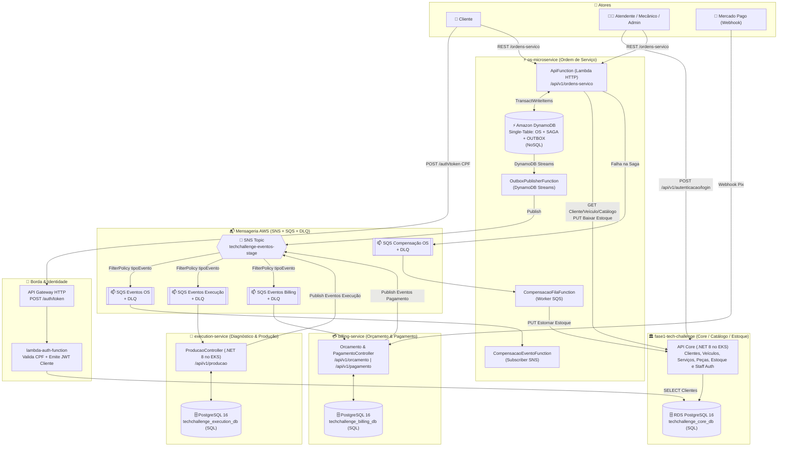

# 📦 Shared — Contratos de Integração (`Fiap.TechChallenge.Contracts`) & Execução Local

Repositório compartilhado entre os microsserviços do **Tech Challenge (Fase 4 — SOAT/FIAP)**:

1. **[`os-microservice`](../os-microservice)**: Microsserviço de **Ordem de Serviço** (AWS Lambda .NET 8 + **DynamoDB NoSQL** + Outbox + Saga de Reserva de Estoque e Compensação).
2. **[`fase1-tech-challenge`](../fase1-tech-challenge)**: Serviço **Core / Catálogo / Clientes / Veículos / Estoque / Staff Auth** (EKS + **PostgreSQL 16 RDS**).
3. **[`execution-service`](../execution-service)**: Microsserviço de **Diagnóstico Técnico e Execução/Produção** de chão de oficina (EKS + **PostgreSQL 16 dedicado**).
4. **[`billing-service`](../billing-service)**: Microsserviço de **Orçamento e Pagamento** integrado ao **Mercado Pago** (EKS + **PostgreSQL 16 dedicado**).
5. **[`lambda-auth-function`](../lambda-auth-function)**: Autenticação Serverless de clientes por **CPF** (AWS API Gateway + AWS Lambda .NET 8).

> 📄 **Documentação Completa e Validação da Fase 4:** veja [`ARQUITETURA_E_VALIDACAO_FASE4.md`](./ARQUITETURA_E_VALIDACAO_FASE4.md) com o diagrama de sequência ponta a ponta, checklist de gaps por repositório e matriz de validação contra os requisitos do edital.

---

## 🏗️ Arquitetura e Fluxo Completo da Aplicação (AWS SNS / SQS)



---

## 📁 Estrutura de Pastas dos Contratos (Separados por Serviço)

```text
shared/
├── src/Fiap.TechChallenge.Contracts/
│   ├── Common/                           # Envelope base IntegrationEvent + atributos SNS/SQS
│   │   ├── IntegrationEvent.cs
│   │   └── SnsMessageAttributes.cs
│   ├── OsService/                        # Contratos do os-microservice
│   │   ├── OrdemServicoEvents.cs
│   │   ├── OrdemServicoCommands.cs
│   │   └── OrdemServicoModels.cs
│   ├── ExecutionService/                 # Contratos do execution-service
│   │   ├── ExecutionEvents.cs
│   │   └── ExecutionModels.cs
│   ├── BillingService/                   # Contratos do billing-service
│   │   ├── BillingEvents.cs
│   │   └── BillingModels.cs
│   ├── CoreService/                      # Contratos do fase1-tech-challenge (Catálogo/Estoque)
│   │   ├── CoreCatalogoContracts.cs
│   │   └── CoreEstoqueEvents.cs
│   └── AuthService/                      # Contratos da lambda-auth-function & JWT
│       └── AuthContracts.cs
├── tests/
│   ├── Fiap.TechChallenge.Contracts.Tests/    # Testes unitários dos contratos compartilhados
│   └── Fiap.TechChallenge.E2ETests/          # Suíte E2E e BDD (Reqnroll/Gherkin) integrada
├── floci/
│   └── init/ready.d/01-init-aws.sh       # Provisiona DynamoDB, SNS, SQS e SSM no Floci
├── docker-compose.yml                    # Orquestração local com Floci + Floci UI
└── Fiap.TechChallenge.Contracts.sln
```

---

## 📜 Matriz de Responsabilidades e Contratos por Serviço

| Pasta / Serviço | Publica no SNS (`tipoEvento`) | Consome do SNS / SQS | Rotas REST Principais |
|---|---|---|---|
| **`OsService/`**<br/>(`os-microservice`) | `OrdemServicoAbertaEvent`<br/>`DiagnosticoRejeitadoEvent`<br/>`DiagnosticoFinalizadoEvent`<br/>`OrdemServicoLiberadaParaExecucaoEvent`<br/>`OrdemServicoCanceladaEvent`<br/>`OrcamentoReprovadoEvent`<br/>`PecasInsumoIncluidasEvent`<br/>`StatusOrdemServicoAlteradoEvent` | `DiagnosticoIniciadoEvent`<br/>`DiagnosticoTecnicoConcluidoEvent`<br/>`ProducaoIniciadaEvent`<br/>`ProducaoFinalizadaEvent`<br/>`ProducaoCanceladaEvent`<br/>`PagamentoConfirmadoEvent`<br/>`PagamentoRecusadoEvent`<br/>`PagamentoCanceladoCompensacaoEvent`<br/>`PagamentoEstornadoEvent`<br/>`ReservaEstoqueFalhouEvent`<br/>+ Fila SQS `ComandoCompensacaoContrato` | `POST /api/v1/ordens-servico`<br/>`GET /api/v1/ordens-servico`<br/>`GET /api/v1/ordens-servico/{id}`<br/>`GET /api/v1/ordens-servico/{id}/progresso`<br/>`PATCH /api/v1/ordens-servico/{id}/aprovar-orcamento`<br/>`PATCH /api/v1/ordens-servico/{id}/confirmar-entrega` |
| **`ExecutionService/`**<br/>(`execution-service`) | `DiagnosticoIniciadoEvent`<br/>`DiagnosticoTecnicoConcluidoEvent`<br/>`ProducaoIniciadaEvent`<br/>`ProducaoFinalizadaEvent`<br/>`ProducaoCanceladaEvent` | `OrdemServicoAbertaEvent`<br/>`DiagnosticoRejeitadoEvent`<br/>`OrdemServicoLiberadaParaExecucaoEvent`<br/>`OrdemServicoCanceladaEvent` | `GET /api/v1/producao/diagnosticos/pendentes`<br/>`PATCH /api/v1/producao/{id}/diagnostico/iniciar`<br/>`POST /api/v1/producao/{id}/diagnostico/finalizar`<br/>`GET /api/v1/producao/fila`<br/>`PATCH /api/v1/producao/{id}/tarefas/{tid}/iniciar`<br/>`PATCH /api/v1/producao/{id}/tarefas/{tid}/finalizar`<br/>`POST /api/v1/producao/{id}/cancelar` |
| **`BillingService/`**<br/>(`billing-service`) | `OrcamentoGeradoEvent`<br/>`PagamentoConfirmadoEvent`<br/>`PagamentoRecusadoEvent`<br/>`PagamentoCanceladoCompensacaoEvent`<br/>`PagamentoEstornadoEvent` | `DiagnosticoFinalizadoEvent`<br/>`ProducaoCanceladaEvent`<br/>`OrdemServicoCanceladaEvent` | `POST /api/v1/orcamento`<br/>`GET /api/v1/orcamento/{id}`<br/>`POST /api/v1/orcamento/{id}/enviar-orcamento`<br/>`POST /api/v1/pagamento`<br/>`GET /api/v1/pagamento/{id}`<br/>`POST /api/v1/pagamento/webhook` |
| **`CoreService/`**<br/>(`fase1-tech-challenge`) | `ReservaEstoqueFalhouEvent` *(se assíncrono)* | Chamadas REST síncronas do `CoreApiClient` | `CRUD /api/v1/clientes`<br/>`CRUD /api/v1/veiculos`<br/>`CRUD /api/v1/servicos`<br/>`CRUD /api/v1/pecas-insumos`<br/>`PUT /api/v1/estoques/{id}/remover-quantidade`<br/>`PUT /api/v1/estoques/{id}/adicionar-quantidade`<br/>`POST /api/v1/autenticacao/login` |
| **`AuthService/`**<br/>(`lambda-auth-function`) | — | — | `POST /auth/token` (`{ "cpf": "..." }`) |

---

## 🚀 Como Executar Localmente com Floci + Floci UI (`shared/`)

### 1. Compilar e testar o pacote de contratos

```bash
cd shared
dotnet build Fiap.TechChallenge.Contracts.sln
dotnet test Fiap.TechChallenge.Contracts.sln
```

### 2. Subir a infraestrutura local (Floci + Floci UI + Bancos PostgreSQL + Serviços)

```bash
cd shared
chmod +x floci/init/ready.d/01-init-aws.sh
docker compose up -d
```

| Serviço Local | Swagger UI / URL | OpenAPI JSON | Descrição |
|---|---|---|---|
| **Core Service (`fase1-tech-challenge`)** | [`http://localhost:8080/swagger`](http://localhost:8080/swagger) | `http://localhost:8080/swagger/v1/swagger.json` | API Core (.NET 8): Catálogo, Clientes, Veículos, Estoque e Staff Auth |
| **OS Service (`os-microservice`)** | [`http://localhost:8083/swagger`](http://localhost:8083/swagger) | `http://localhost:8083/swagger/v1/swagger.json` | API de Ordem de Serviço (.NET 8 Lambda + DynamoDB NoSQL + Saga) |
| **Execution Service (`execution-service`)** | [`http://localhost:8082/swagger`](http://localhost:8082/swagger) | `http://localhost:8082/swagger/v1/swagger.json` | API de Diagnóstico e Produção (.NET 8 + PostgreSQL dedicado) |
| **Billing Service (`billing-service`)** | [`http://localhost:8081/swagger`](http://localhost:8081/swagger) | `http://localhost:8081/swagger/v1/swagger.json` | API de Orçamento e Pagamento (.NET 8 + PostgreSQL dedicado) |
| **Floci (AWS Emulator)** | `http://localhost:4566` | — | Emulador AWS para SNS, SQS, DynamoDB e SSM |
| **Floci UI (Web Console)** | [`http://localhost:4500`](http://localhost:4500) | — | Dashboard visual para inspecionar tópicos SNS, filas SQS, tabelas DynamoDB e SSM |
| **Grafana (Observabilidade)** | [`http://localhost:3000`](http://localhost:3000) | — | Dashboards de Métricas, Logs JSON (`correlation_id`) e Traces (`admin` / `admin`) |
| **Prometheus** | [`http://localhost:9090`](http://localhost:9090) | — | Coleta de `/metrics` e probes HTTP (`blackbox-exporter`) dos 4 microsserviços |
| **Alertmanager** | [`http://localhost:9093`](http://localhost:9093) | — | Gestão de alertas do Prometheus + webhook local (`:9094`) |
| **Loki & Tempo (via OTel Collector)** | `http://localhost:3100` / `:3200` | — | Backends de Logs estruturados e Traces distribuídos (OTLP `:4319` gRPC / `:4320` HTTP) |

O container `floci` executa automaticamente o hook [`floci/init/ready.d/01-init-aws.sh`](floci/init/ready.d/01-init-aws.sh) ao iniciar, criando:
### 3. Executar os Testes E2E e BDD Reqnroll (Fluxo Completo Integrado)

Com o ecossistema em execução (`docker compose up -d`), execute os testes BDD integrados que validam ponta a ponta o ciclo de vida da OS, catálogo, DynamoDB e mensageria:

```bash
cd shared
dotnet test tests/Fiap.TechChallenge.E2ETests/Fiap.TechChallenge.E2ETests.csproj --logger "console;verbosity=normal"
```

Cenários BDD cobertos:
1. **`1_CicloCompletoOrdemServico.feature`**: Abertura, Diagnóstico Técnico, Inclusão de Peças/Serviços, Aprovação de Orçamento, Execução e Confirmação de Entrega (validando APIs HTTP + persistência física em DynamoDB NoSQL e PostgreSQL do Execution Service).
2. **`2_SagaCompensacaoFalhaEstoque.feature`**: Resiliência e validação transacional da Saga de Estoque.
3. **`3_SanidadeEContratosMicrosservicos.feature`**: Health checks integrados e comunicação com emulador Floci (DynamoDB, tópicos SNS e filas SQS).
